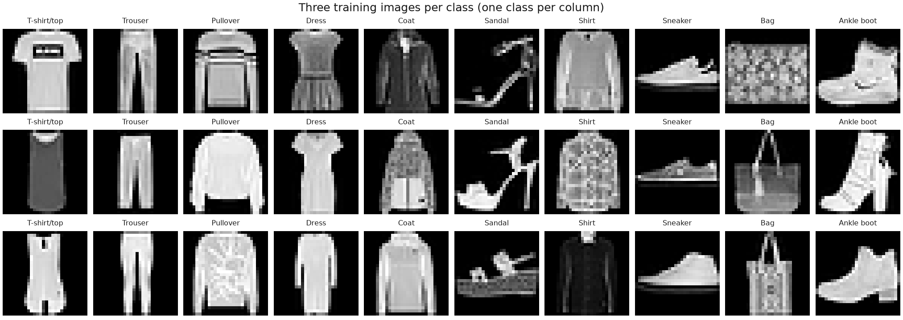
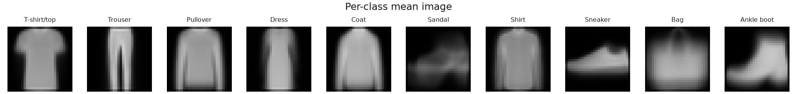
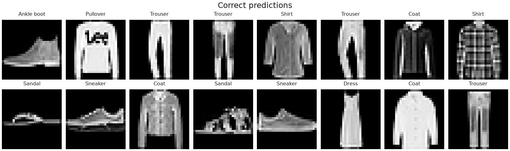
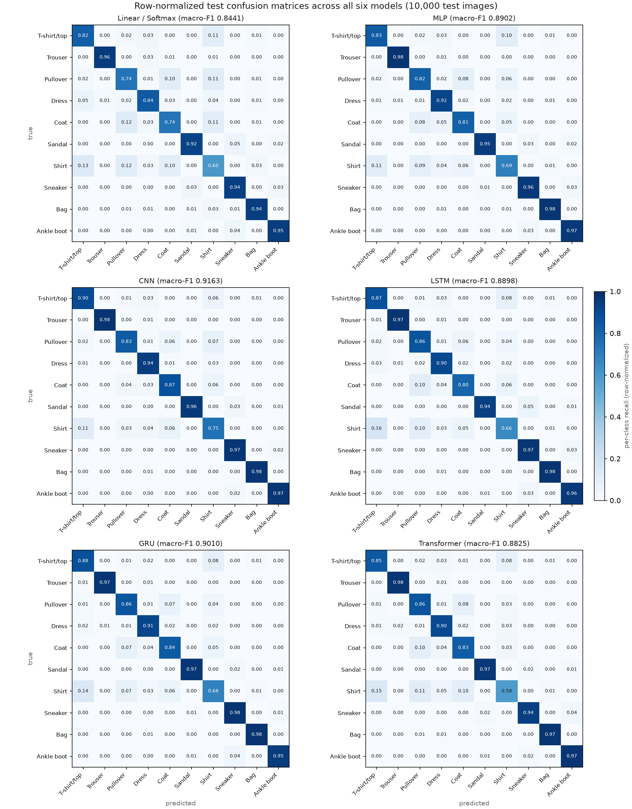

# CO3133 — Deep Learning and Its Applications
## Assignment 1 Final Report: Foundations of Deep Learning Pipelines and Architectures on Fashion-MNIST

- **Course:** CO3133 — Deep Learning and Its Applications (Semester 261)
- **Instructor:** Assoc. Prof. Dr. Lê Thành Sách
- **Institution:** Faculty of Computer Science and Engineering, Ho Chi Minh City University of Technology (HCMUT), VNU-HCM
- **Group:** Nhóm CR7 (3 members)
  - Trần Hoàng Vỹ Khang — `2352502`
  - Đỗ Đăng Khoa — `2352554`
  - Dương Đăng Khoa — `2352551`
- **Repository:** [https://github.com/THVKhang/ALearning/tree/main/assignment1](https://github.com/THVKhang/ALearning/tree/main/assignment1)
- **Assignment Web Page:** [https://thvkhang.github.io/ALearning/assignment1/](https://thvkhang.github.io/ALearning/assignment1/)
- **Shared Course Landing Page:** [https://thvkhang.github.io/ALearning/](https://thvkhang.github.io/ALearning/)

---

## Part 1 — Problem and Data Description

### 1.1 Problem Formulation
- **Real-world motivation:** Automated garment classification underpins e-commerce catalog indexing, visual search, and retail inventory tagging, where products often arrive as studio thumbnails without reliable category metadata. Methodologically, classifying low-resolution apparel images provides a controlled testbed to investigate how **input data representation** (1D flattened pixel vectors vs. 2D spatial grids vs. 1D horizontal row sequences) and **architectural inductive bias** govern accuracy, parameter efficiency, and inference latency when all training settings are held constant.
- **Input:** A single-channel grayscale image $X \in \mathbb{R}^{1 \times 28 \times 28}$ ($784$ pixel intensities once flattened) representing a centered article of clothing.
- **Output:** A categorical class index $\hat{y} \in \{0, 1, \dots, 9\}$ corresponding to one of 10 garment categories (`T-shirt/top`, `Trouser`, `Pullover`, `Dress`, `Coat`, `Sandal`, `Shirt`, `Sneaker`, `Bag`, `Ankle boot`), obtained from raw unnormalized class logits $z = f_\theta(X) \in \mathbb{R}^{10}$.
- **Prediction unit:** One independent class prediction per $28 \times 28$ image.
- **Mathematical formulation:** Given a labeled training set $\mathcal{D}_{\text{train}} = \{(X_i, y_i)\}_{i=1}^{N_{\text{train}}}$, a parametric neural network $f_\theta: \mathbb{R}^{1 \times 28 \times 28} \to \mathbb{R}^{10}$ maps each image $X_i$ to unnormalized logits $z_i = f_\theta(X_i)$. We optimize the parameters $\theta$ by minimizing the multi-class Cross-Entropy loss over the training split:
  $$\mathcal{L}(\theta) = -\frac{1}{N_{\text{train}}} \sum_{i=1}^{N_{\text{train}}} \log \frac{\exp(z_{i, y_i})}{\sum_{c=0}^{9} \exp(z_{i, c})}$$
  At inference time, the predicted category is $\hat{y}_i = \arg\max_{c \in \{0,\dots,9\}} z_{i, c}$.
- **Main difficulties:**
  1. **Silhouette overlap among upper-body garments:** Four categories — `T-shirt/top` (0), `Pullover` (2), `Coat` (4), and `Shirt` (6) — share nearly identical outer torso boundaries and differ primarily in fine interior cues (collars, button plackets, sleeve seams, or knit textures).
  2. **Low spatial resolution and absence of color:** Downsampling studio photographs to $28 \times 28$ single-channel grayscale removes color cues and compresses fine details into 1–2 pixel intensity transitions.
  3. **Intra-class geometric variation:** Categories such as `Bag` (8), `Sandal` (5), and `Ankle boot` (9) vary substantially in strap geometry, handle orientation, and heel profile.

### 1.2 Dataset Description and Dataset Roles
In compliance with Section 10 of the Course Handbook, the exact role of each dataset in our project is stated below:

| Dataset | Role in This Project | Scope and Usage |
| :--- | :--- | :--- |
| **MNIST** | **Development & Debugging Only** | Supported in [`src/data/dataset.py`](https://github.com/THVKhang/ALearning/blob/main/assignment1/src/data/dataset.py) (`--dataset mnist`) strictly for initial pipeline verification and shape checks. No experimental claims are reported on MNIST. |
| **Fashion-MNIST** | **Primary Benchmark Dataset** | Used for **all main experimental comparisons**, exploratory data analysis, learning curves, confusion matrices, and qualitative analyses. |
| **CIFAR-10** | **Not Evaluated (Optional)** | Not used; for our optional Section 11.2 extension, we instead conducted a controlled **LSTM vs. GRU** recurrent comparison on Fashion-MNIST. |

- **Source, version, and license:** Fashion-MNIST was published by Xiao, Rasul, and Vollgraf (Zalando Research, 2017) under the **MIT License** and obtained through `torchvision.datasets.FashionMNIST`.
- **Collection and labeling process:** Derived from product photographs on Zalando's e-commerce platform. Each original color image was converted to grayscale, cropped to its bounding box, resized into a $28 \times 28$ frame while preserving aspect ratio, and assigned its catalog product category label.
- **Sample counts and annotations:** $70{,}000$ images in total — $60{,}000$ official development (`train=True`) images and $10{,}000$ official test (`train=False`) images — across $10$ mutually exclusive classes.
- **Storage size and format:** Compressed IDX binary files (`train-images-idx3-ubyte.gz`, `train-labels-idx1-ubyte.gz`, `t10k-images-idx3-ubyte.gz`, `t10k-labels-idx1-ubyte.gz`), occupying $\sim 30\text{ MB}$ on disk.
- **Bias and limitations:** Studio-lit, clean-background thumbnails ($\sim 50.2\%$ exact-zero black background pixels) do not capture real-world background clutter, lighting shifts, occlusion, or on-body human pose deformations.

### 1.3 Exploratory Data Analysis (EDA)
Our exploratory analysis in [`notebooks/eda.ipynb`](https://github.com/THVKhang/ALearning/blob/main/assignment1/notebooks/eda.ipynb) examines all required EDA dimensions on Fashion-MNIST:

1. **Input size and pixel statistics:** Every sample is a $1 \times 28 \times 28$ grayscale raster ($784$ features once flattened) with raw `uint8` intensities in $[0, 255]$. Scaled to $[0.0, 1.0]$, the pixel mean and standard deviation measured over the $60{,}000$ official development images (`train=True`) in [`notebooks/eda.ipynb`](https://github.com/THVKhang/ALearning/blob/main/assignment1/notebooks/eda.ipynb) are $\mu = 0.2860$ and $\sigma = 0.3530$ (and because our $90/10$ train/validation split is stratified, the $54{,}000$-image training subset has the exact same $\mu = 0.2860, \sigma = 0.3530$ to four decimal places). Exactly $50.2\%$ of all pixels are `0.0` (black background), yielding a bimodal intensity distribution.
2. **Class distribution and imbalance analysis:** Every class $c \in \{0, \dots, 9\}$ has **exactly $6{,}000$ official development images** ($5{,}400$ train + $600$ validation after our stratified $90/10$ split) and **exactly $1{,}000$ official test images** ($10.0\%$ per class in every split). This yields an **imbalance ratio of $1.0000$** ($\max_c N_c / \min_c N_c = 1.0$) and a **normalized Shannon entropy of $1.0000$**. Because the dataset is perfectly balanced, no class weighting or resampling is needed, a uniform random guess scores $10.0\%$, and overall accuracy and macro-F1 are expected to agree closely.
3. **Representative samples and per-class mean images:**
   - **Figure 1** displays a $3 \times 10$ grid of **representative training samples** (three random training images per class, one class per column), illustrating intra-class variations in sleeve cut, garment print, footwear strap, and bag handle geometry.
   - **Figure 2** displays the **per-class mean images** across the 10 categories. Visually, `Trouser`, `Bag`, `Sandal`, `Sneaker`, and `Ankle boot` each average to a sharp, distinct silhouette, whereas `T-shirt/top`, `Pullover`, `Coat`, and `Shirt` average to nearly the same blurry torso template — predicting before any model is trained where classification errors will concentrate.





### 1.4 Data Splitting
All six models in our comparison use the **exact same data partitions** generated in [`src/data/dataset.py`](https://github.com/THVKhang/ALearning/blob/main/assignment1/src/data/dataset.py):
- **Split policy:** We preserve the **official test set** ($10{,}000$ images) untouched and partition the official $60{,}000$-image development set into a **custom $90\% / 10\%$ train/validation split** (`val_fraction = 0.1`).
- **Random seed and stratification:** Using [`split_indices`](https://github.com/THVKhang/ALearning/blob/main/assignment1/src/data/dataset.py#L38-L53) with `np.random.default_rng(seed=42)` and `stratified = True`, each class's $6{,}000$ indices are shuffled deterministically and partitioned into $5{,}400$ train and $600$ validation indices.
- **Exact sample counts:**
  - **Train split:** $54{,}000$ images ($5{,}400$ per class).
  - **Validation split:** $6{,}000$ images ($600$ per class).
  - **Test split:** $10{,}000$ images ($1{,}000$ per class).
- **Split unit and leakage prevention:** The split unit is one image (Fashion-MNIST has no multi-view subject or session grouping). [`scripts/train.py`](https://github.com/THVKhang/ALearning/blob/main/assignment1/scripts/train.py) never constructs or accesses the test `DataLoader`; the test split is loaded only by [`scripts/eval.py`](https://github.com/THVKhang/ALearning/blob/main/assignment1/scripts/eval.py) after checkpoint selection on validation Macro-F1 is finished. In [`src/data/dataset.py`](https://github.com/THVKhang/ALearning/blob/main/assignment1/src/data/dataset.py#L65-L68), `train_source` and `val_source` are instantiated as two separate dataset views so that when training augmentation is enabled, validation never receives augmented images. *(Note on normalization constants: `mean = 0.2860` and `std = 0.3530` in [`src/data/dataset.py`](https://github.com/THVKhang/ALearning/blob/main/assignment1/src/data/dataset.py#L14-L15) are the standard constants measured on the $60{,}000$-image official `train=True` set in [`notebooks/eda.ipynb`](https://github.com/THVKhang/ALearning/blob/main/assignment1/notebooks/eda.ipynb); while this includes the $6{,}000$ validation images in those two global scalar statistics, recomputing on the $54{,}000$ training subset alone yields the exact same `0.2860` and `0.3530` to four decimal places, and the $10{,}000$ test set is completely excluded.)*

### 1.5 Preprocessing and Input Representations
- **Cleaning and invalid annotations:** All $70{,}000$ images have valid $28 \times 28$ pixel grids and integer labels in $\{0,\dots,9\}$ with no missing or corrupted entries.
- **Normalization and augmentation policy:** Raw `uint8` pixels in $[0, 255]$ are scaled to $[0.0, 1.0]$ by `transforms.ToTensor()` and standardized by `transforms.Normalize(mean=(0.2860,), std=(0.3530,))`:
  $$\tilde{X} = \frac{X / 255.0 - 0.2860}{0.3530}$$
  Although [`src/data/dataset.py:build_transform`](https://github.com/THVKhang/ALearning/blob/main/assignment1/src/data/dataset.py#L30-L35) implements optional training-only `RandomHorizontalFlip()` and `RandomCrop(28, padding=2)`, we set `augment: false` in [`configs/default.yaml`](https://github.com/THVKhang/ALearning/blob/main/assignment1/configs/default.yaml) across all six main runs so the architectural comparison is not confounded by random cropping.
- **Input tensor shapes and one example batch after preprocessing:**
  - The `DataLoader` (`batch_size = 128`) yields mini-batches of shape `(128, 1, 28, 28)` (`dtype = float32`) and label tensors of shape `(128,)` (`dtype = int64`).
  - Measured on one preprocessed training batch in [`notebooks/eda.ipynb`](https://github.com/THVKhang/ALearning/blob/main/assignment1/notebooks/eda.ipynb), the batch has **mean `0.0073` and std `0.9989`** (with pixel values spanning $[-0.8102, +2.0227]$), confirming proper standardization.
  - Each model family reshapes `(B, 1, 28, 28)` into its required view:
    1. **Linear & MLP:** Flattened to `(B, 784)` via `nn.Flatten()`.
    2. **CNN:** Kept as a 2D spatial grid `(B, 1, 28, 28)`.
    3. **LSTM, GRU & Transformer:** Converted by [`src/data/sequence.py:to_sequence`](https://github.com/THVKhang/ALearning/blob/main/assignment1/src/data/sequence.py) (`sequence = "rows"`) into `(B, 28, 28)` — a top-to-bottom sequence of $T = 28$ horizontal row tokens, each of length $D_{\text{in}} = 28$. (The module also supports `columns` and $7 \times 7$ `patches`.)

---

## Part 2 — Methodology

### 2.1 Pipeline Overview
Our end-to-end pipeline follows the structure required by Handbook Section 3.2:

```
Raw data (Fashion-MNIST IDX 28x28 uint8)
  --> Preprocessing (ToTensor + Normalize(mean=0.2860, std=0.3530))
  --> DataLoader (Stratified 54,000 train / 6,000 val / 10,000 test, batch_size=128, seed=42)
  --> Model (Linear | MLP | CNN | LSTM | GRU | Transformer -> raw logits R^10)
  --> Loss (nn.CrossEntropyLoss on unnormalized logits)
  --> Optimization (Adam, lr=1e-3, weight_decay=0.0, max 15 epochs, patience=5)
  --> Prediction (argmax over 10 class logits)
  --> Post-processing (Restore best.pt checkpoint selected by validation Macro-F1)
  --> Evaluation (Test Accuracy, Macro-F1, Per-Class F1, Confusion Matrix, Latency)
```

### 2.2 Baseline and Main Methods
All six models are self-implemented in [`src/models/`](https://github.com/THVKhang/ALearning/tree/main/assignment1/src/models) using core `torch.nn` layers (`nn.Linear`, `nn.Conv2d`, `nn.BatchNorm2d`, `nn.MaxPool2d`, `nn.LSTM`, `nn.GRU`, `nn.TransformerEncoderLayer`, `nn.LayerNorm`, `nn.Dropout`). **No pretrained weights or `torchvision.models` backbones are used.** Every model returns raw unnormalized logits $z \in \mathbb{R}^{B \times 10}$ directly to `nn.CrossEntropyLoss` without applying `Softmax` beforehand.

#### 1. Linear / Softmax Classifier ([`src/models/linear.py`](https://github.com/THVKhang/ALearning/blob/main/assignment1/src/models/linear.py)) — *Baseline*
- **Input representation:** Flattened pixel vector $x \in \mathbb{R}^{B \times 784}$ (`nn.Flatten()`).
- **Architecture:** A single affine map `nn.Linear(784, 10)` producing logits $z = xW^\top + b$.
- **Parameter count & compute:** $\mathbf{7{,}850}$ trainable parameters; $\mathbf{7{,}840\text{ MACs}}$ ($\approx 0.008\text{ MMACs} / 15.7\text{ KFLOPs}$) per image.
- **Strengths & limits:** Convex in its parameters and extremely fast (`0.0006 ms/image` model-only latency), establishing a lower-bound linear baseline. However, its decision boundary is a hyperplane in raw pixel space that cannot express nonlinear pixel interactions or 2D neighborhood structure.

#### 2. Multilayer Perceptron — MLP ([`src/models/mlp.py`](https://github.com/THVKhang/ALearning/blob/main/assignment1/src/models/mlp.py))
- **Input representation:** Flattened pixel vector $x \in \mathbb{R}^{B \times 784}$.
- **Architecture (`hidden_sizes = [256]`, `dropout = 0.2`):**
  $$\text{Flatten}() \to \text{Linear}(784, 256) \to \text{ReLU}() \to \text{Dropout}(0.2) \to \text{Linear}(256, 10)$$
- **Activation & regularization explanation:** Without a nonlinearity, stacked linear layers collapse into a single linear map identical to the baseline. We use `ReLU(z) = max(0, z)` because its gradient is $1$ on positive activations, avoiding vanishing gradients. Regularization is provided by `Dropout(0.2)`, which zeroes a random $20\%$ of hidden units at each training step so the classifier cannot rely on fragile co-adapted features, and is disabled during evaluation via `model.eval()`.
- **Parameter count & compute:** $\mathbf{203{,}530}$ trainable parameters; $\mathbf{203{,}264\text{ MACs}}$ ($\approx 0.20\text{ MMACs} / 0.41\text{ MFLOPs}$) per image.
- **Strengths & limits:** Models nonlinear combinations of pixels across the whole image, but because it consumes a flat vector, it has no notion that adjacent pixels are spatial neighbors.

#### 3. Convolutional Neural Network — CNN ([`src/models/cnn.py`](https://github.com/THVKhang/ALearning/blob/main/assignment1/src/models/cnn.py))
- **Input representation:** 2D spatial grid $X \in \mathbb{R}^{B \times 1 \times 28 \times 28}$.
- **Architecture (self-designed 2-block ConvNet, `channels = [32, 64]`, `dropout = 0.2`):**
  - **Block 1:** `Conv2d(1, 32, kernel_size=3, padding=1)` $\to$ `BatchNorm2d(32)` $\to$ `ReLU()` $\to$ `MaxPool2d(2)` ($28 \times 28 \to 14 \times 14$).
  - **Block 2:** `Conv2d(32, 64, kernel_size=3, padding=1)` $\to$ `BatchNorm2d(64)` $\to$ `ReLU()` $\to$ `MaxPool2d(2)` ($14 \times 14 \to 7 \times 7$).
  - **Classifier head:** `Flatten()` ($64 \times 7 \times 7 = 3{,}136$) $\to$ `Dropout(0.2)` $\to$ `Linear(3136, 10)`.
- **Convolution, pooling, and feature maps explanation:**
  - *Convolution:* A learned $3 \times 3$ kernel slides over the 2D input and computes local weighted sums. Because the same kernel is reused at every $(i, j)$ location, local patterns (such as vertical edges or collar seams) are detected wherever they appear using only $3 \times 3 \times C_{\text{in}}$ weights per output channel. With `padding = 1`, convolution preserves spatial dimensions.
  - *Feature maps:* Each kernel produces one 2D feature map whose value at $(i, j)$ measures how strongly its pattern fires around pixel $(i, j)$. Block 1 emits $32$ edge/gradient feature maps, and Block 2 convolves across all $32$ maps simultaneously to emit $64$ composite texture and garment-part maps. `BatchNorm2d` normalizes each feature map over the batch to keep activation scales stable.
  - *Pooling:* `MaxPool2d(2)` retains the maximum value in each $2 \times 2$ window, halving height and width ($28 \times 28 \to 14 \times 14 \to 7 \times 7$). This provides local translation tolerance, reduces activation size $4\times$ per block, and doubles the original image area that the next $3 \times 3$ kernel sees.
- **Parameter count & compute:** $\mathbf{50{,}378}$ trainable parameters ($4.0\times$ fewer than the MLP); $\mathbf{3{,}869{,}824\text{ MACs}}$ ($\approx 3.87\text{ MMACs} / 7.74\text{ MFLOPs}$) per image.
- **Strengths & limits:** Supplies 2D spatial locality and translation equivariance as architectural priors, achieving the highest accuracy with compact parameter count.

#### 4. Recurrent Neural Networks — LSTM & GRU ([`src/models/rnn.py`](https://github.com/THVKhang/ALearning/blob/main/assignment1/src/models/rnn.py)) — *Core + Section 11.2 Extension*
- **Input representation (row sequence via [`src/data/sequence.py`](https://github.com/THVKhang/ALearning/blob/main/assignment1/src/data/sequence.py)):** Each image is read top-to-bottom as $X_{\text{seq}} \in \mathbb{R}^{B \times 28 \times 28}$ (`sequence = "rows"`).
  - **Timestep ($T = 28$):** Each timestep $t \in \{1, \dots, 28\}$ corresponds to one horizontal image row from top ($t=1$) to bottom ($t=28$).
  - **Input size ($D_{\text{in}} = 28$):** Each token $x_t \in \mathbb{R}^{28}$ contains the $28$ pixel intensities of row $t$.
- **Architecture & hidden representation (`hidden_size = 128`, `num_layers = 1`, `dropout = 0.2`):**
  - The recurrent cell carries a hidden state $h_t \in \mathbb{R}^{128}$ updated at every step from $(x_t, h_{t-1})$.
  - **GRU (`cell = "gru"`):** Uses two gates (update and reset) to control how much of $h_{t-1}$ to retain and how much of the new candidate state to write.
  - **LSTM (`cell = "lstm"`):** Adds a separate cell state $c_t \in \mathbb{R}^{128}$ and a third gate (input, forget, output) so information can be carried along $c_t$ across many steps.
  - **Readout head:** The final hidden state $h_{28} \in \mathbb{R}^{B \times 128}$ (`outputs[:, -1]`) summarizes the whole 28-row scan and passes through `Dropout(0.2)` $\to$ `Linear(128, 10)`.
- **Parameter counts & compute:**
  - **GRU:** $\mathbf{61{,}962}$ trainable parameters; $\mathbf{1{,}678{,}592\text{ MACs}}$ ($\approx 1.68\text{ MMACs} / 3.36\text{ MFLOPs}$) per image.
  - **LSTM:** $\mathbf{82{,}186}$ trainable parameters; $\mathbf{2{,}237{,}696\text{ MACs}}$ ($\approx 2.24\text{ MMACs} / 4.48\text{ MFLOPs}$) per image.
- **Strengths & limits:** Keeps horizontal structure intact within each row and shares weights across vertical scan steps, but destroys vertical pixel adjacency and must pass evidence from row 1 through 27 sequential updates before reaching the classifier.

#### 5. Transformer Encoder Classifier ([`src/models/transformer.py`](https://github.com/THVKhang/ALearning/blob/main/assignment1/src/models/transformer.py))
- **Input representation:** Same sequence of $T = 28$ horizontal row tokens $X_{\text{seq}} \in \mathbb{R}^{B \times 28 \times 28}$ (`sequence = "rows"`).
- **Token projection, `[CLS]` token, and positional encoding:**
  - *Token projection:* `nn.Linear(28, 128)` maps each 28-pixel row token to width $d_{\text{model}} = 128$.
  - *Classification token (`cls_token`):* A learnable vector of shape $(1, 1, 128)$ is prepended to the 28 row embeddings, yielding $T + 1 = 29$ tokens.
  - *Positional encoding (`positions`):* Because self-attention is permutation-invariant (shuffling the rows would leave the `[CLS]` summary unchanged), a learnable parameter of shape $(1, 29, 128)$ is added to the token embeddings before the encoder stack.
- **Attention inputs, mechanism, and outputs:**
  - The sequence passes through $2$ pre-norm `nn.TransformerEncoderLayer` blocks (`d_model = 128`, `nhead = 4`, per-head width $d_{\text{head}} = 32$, `dim_feedforward = 256`, `dropout = 0.2`, `activation = "gelu"`, `norm_first = True`).
  - Each layer linearly projects the input sequence $(B, 29, 128)$ into queries $Q$, keys $K$, and values $V$. Scaled dot-product attention computes pairwise scores $q_i \cdot k_j / \sqrt{32}$ and applies softmax over $j$, producing an output at position $i$ that is a relevance-weighted mixture of *every* row in the image (a global receptive field from layer 1). Four heads run in parallel over 32 channels each and are concatenated.
  - After the encoder, `nn.LayerNorm(128)` is applied to the `[CLS]` slot (`encoded[:, 0]`) and mapped to 10 logits via `nn.Linear(128, 10)`.
- **Parameter count & compute:** $\mathbf{274{,}058}$ trainable parameters; $\mathbf{8{,}134{,}400\text{ MACs}}$ ($\approx 8.13\text{ MMACs} / 16.27\text{ MFLOPs}$) per image.
- **Strengths & limits:** Assumes the least about spatial structure (any row can attend to any other in one step), which is a strength at large scale but a weakness on $54{,}000$ small images where locality must be learned from scratch through positional embeddings.

### 2.3 Training Setup
To isolate architectural and representation effects, **all six models use the exact same training configuration** defined in [`configs/default.yaml`](https://github.com/THVKhang/ALearning/blob/main/assignment1/configs/default.yaml) and executed by [`src/engine/trainer.py`](https://github.com/THVKhang/ALearning/blob/main/assignment1/src/engine/trainer.py):
- **Optimizer & learning rate:** `torch.optim.Adam` with $\text{lr} = 10^{-3}$ (`0.001`), `weight_decay = 0.0`, and no learning-rate scheduler.
- **Batch size & epoch budget:** `batch_size = 128` (`num_workers = 0`), maximum `epochs = 15`.
- **Regularization:** `Dropout(0.2)` on all models except the linear baseline; `BatchNorm2d` in the CNN; `LayerNorm` in the Transformer.
- **Early stopping & checkpoint selection rule:** Early stopping monitors validation `macro_f1` with `patience = 5` epochs (never triggered; all six runs completed 15 epochs). After each epoch, `best.pt` is overwritten whenever validation Macro-F1 improves. Test evaluation in [`scripts/eval.py`](https://github.com/THVKhang/ALearning/blob/main/assignment1/scripts/eval.py) loads `best.pt`.
- **Seed & determinism:** `seed = 42` applied via [`src/utils/seed.py`](https://github.com/THVKhang/ALearning/blob/main/assignment1/src/utils/seed.py) to `random`, `numpy`, `torch`, and `torch.cuda`, with `torch.backends.cudnn.deterministic = True` and `cudnn.benchmark = False`.
- **Hardware & software environment (from [`outputs/cnn_fashion_mnist_seed42/config.json`](https://github.com/THVKhang/ALearning/blob/main/assignment1/outputs/cnn_fashion_mnist_seed42/config.json)):**
  - **Hardware:** NVIDIA GeForce RTX 3050 Laptop GPU (4 GB VRAM, CUDA `13.0`), Windows 11 (`build 10.0.26300`).
  - **Software:** Python `3.13.14`, PyTorch `2.14.0+cu130`, torchvision `0.29.0+cu130`, NumPy `2.5.3`, scikit-learn `1.9.1`. Mixed precision was not used (`fp32`). All six runs were executed back-to-back in one session at commit `8e407ed`.

### 2.4 Experimental Design
- **Experiment 1 — Core 5-Family Architectural & Representation Benchmark (`Linear`, `MLP`, `CNN`, `LSTM`/`GRU`, `Transformer`):**
  - **Hypothesis ($H_1$):** Performance on Fashion-MNIST is governed less by raw parameter count than by how much 2D spatial structure the input representation and inductive bias preserve (`2D grid CNN > 1D row sequence RNN/Transformer > 1D flattened MLP/Linear`), and architectural differences will concentrate on the four upper-body classes (`Shirt`, `T-shirt/top`, `Pullover`, `Coat`) that share a global silhouette.
  - **Changed factor:** Model architecture and input representation (`(B, 784)` flat vector vs. `(B, 1, 28, 28)` 2D grid vs. `(B, 28, 28)` row sequence).
  - **Fixed factors:** Dataset (`Fashion-MNIST`), stratified split (`54,000 / 6,000 / 10,000`, `seed = 42`), preprocessing (`Normalize(0.2860, 0.3530)`), loss (`CrossEntropyLoss`), optimizer (`Adam`, `lr = 1e-3`, `wd = 0`), batch size (`128`), epoch budget (`15`), and checkpoint rule (`best validation Macro-F1`).
  - **Metrics & 3-tier conclusion criteria (for single-seed evaluation):** We evaluate Test Accuracy, Test Macro-F1, Per-Class F1 (especially the upper-body 4 vs. other 6 gap), parameter count, FLOPs/MACs, training time, and inference latency. Because all runs use a single seed (`seed = 42`), we interpret Test Macro-F1 margins ($\Delta$) across three complete, non-overlapping tiers:
    1. **$\Delta < 0.01$ (Inconclusive / Practically Tied in this run):** Margins below $1.0\text{ percentage point}$ (e.g., `MLP 0.8902` vs. `LSTM 0.8898` at $\Delta = 0.0004$, and `LSTM 0.8898` vs. `Transformer 0.8825` at $\Delta = 0.0073$) lie within single-seed stochastic noise and cannot support superiority claims without multi-seed `mean ± std`.
    2. **$0.01 \le \Delta \le 0.02$ (Moderate Empirical Advantage when corroborated by lower parameters and per-class consistency):** Margins between $1.0$ and $2.0\text{ percentage points}$ — such as **CNN (`0.9163`) vs. GRU (`0.9010`)** ($\Delta = +0.0153$, where CNN wins all 10 classes with $18.7\%$ fewer parameters) and **GRU (`0.9010`) vs. MLP (`0.8902`)** ($\Delta = +0.0108$, where GRU wins 8 of 10 classes with $3.3\times$ fewer parameters) — indicate a meaningful advantage in this run when achieved with *fewer* parameters, though multi-seed runs remain desirable to bound variance.
    3. **$\Delta > 0.02$ (Large, Decisive Structural Separation):** Margins exceeding $2.0\text{ percentage points}$ (e.g., `CNN 0.9163` vs. `MLP 0.8902` at $+0.0261$, `CNN` vs. `Transformer` at $+0.0338$, and all nonlinear models vs. `Linear 0.8441` at $+0.0384$ to $+0.0722$) represent clear architectural separations.

- **Experiment 2 — Optional Extension (Section 11.2): `LSTM` vs. `GRU` on Row Sequences:**
  - **Hypothesis ($H_2$):** Over a short 28-step row sequence with identical hidden width (`128`) and depth (`1` layer), the 2-gate **GRU** will match or exceed the 3-gate **LSTM** in Macro-F1 while requiring $\sim 25\%$ fewer parameters and fewer FLOPs.
  - **Changed factor:** Recurrent cell type (`nn.LSTM` vs. `nn.GRU`).
  - **Fixed factors:** Row sequence (`28` steps $\times$ `28` features), `hidden_size = 128`, `num_layers = 1`, `dropout = 0.2`, classifier head (`Linear(128, 10)`), and all training settings.

---

## Part 3 — Implementation Results

### 3.1 Training Behavior
**Figure 3** shows the 15-epoch training and validation Cross-Entropy Loss and Macro-F1 curves for **all six architectures**, plotted directly from [`outputs/*_fashion_mnist_seed42/history.json`](https://github.com/THVKhang/ALearning/tree/main/assignment1/outputs) by [`scripts/compare.py`](https://github.com/THVKhang/ALearning/blob/main/assignment1/scripts/compare.py).


- **Convergence dynamics, underfitting vs. overfitting, and selected checkpoints (verified against `history.json`):**
  - **Linear:** Exhibits **high-bias structural underfitting** compared to the nonlinear models (plateauing around `0.385` training loss and `0.865` training Macro-F1 because its hyperplane cannot bend), while also showing **mild late-epoch overfitting** after **epoch 11 / 15**: validation Macro-F1 peaks at epoch 11 (`val_macro_f1 = 0.8536`, `val_loss = 0.4186`, `train_loss = 0.3935`), after which training loss keeps edging down to `0.3853` at epoch 15 while validation loss drifts upward to `0.4287` (`val_macro_f1 = 0.8446`). Selecting `best.pt` at epoch 11 absorbs this late drift.
  - **MLP:** Improves steadily across the entire schedule and selects the final epoch, **epoch 15 / 15** (`val_macro_f1 = 0.8991`, `val_loss = 0.2887`, `train_loss = 0.2145`, `train_macro_f1 = 0.9197`). Because validation Macro-F1 was still rising at epoch 15, the MLP has **not fully saturated** its 15-epoch budget.
  - **CNN:** Converges fastest, surpassing `0.90` validation Macro-F1 by epoch 3 (`0.9066`) and reaching its best checkpoint at **epoch 13 / 15** (`val_macro_f1 = 0.9183`, `val_accuracy = 0.9185`, `val_loss = 0.2323`, `train_loss = 0.1562`). In epochs 14–15, training loss drops further to `0.1447` while validation Macro-F1 dips slightly to `0.9155`, which the epoch-13 checkpoint rule cleanly avoids.
  - **LSTM & GRU:** Both recurrent models peak at **epoch 13 / 15** (`val_macro_f1 = 0.8959`, `val_accuracy = 0.8970` for LSTM; `val_macro_f1 = 0.9032`, `val_accuracy = 0.9038` for GRU) and plateau in epochs 13–15.
  - **Transformer:** Selects the final epoch, **epoch 15 / 15** (`val_macro_f1 = 0.8953`, `val_accuracy = 0.8970`, `val_loss = 0.2949`, `train_loss = 0.2695`). Both training and validation losses are still trending downward at epoch 15, demonstrating that the 274K-parameter self-attention encoder **has not yet converged** under a fixed 15-epoch schedule without warmup.
- **Implementation issues encountered and resolved:**
  1. *cuDNN non-determinism in CNN:* Seeding `random`, `numpy`, and `torch` reproduced Linear, MLP, LSTM, GRU, and Transformer to every digit, but cuDNN's runtime convolution algorithm selector caused the CNN's best validation Macro-F1 to shift between `0.9208` (epoch 9) and `0.9202` / `0.9183` (epoch 13) across runs on the same GPU. Setting `torch.backends.cudnn.deterministic = True` and `cudnn.benchmark = False` in [`src/utils/seed.py`](https://github.com/THVKhang/ALearning/blob/main/assignment1/src/utils/seed.py) made the CNN bit-for-bit reproducible (verified across two 3-epoch test runs matching on train loss `0.4268 / 0.2987 / 0.2680` and val Macro-F1 `0.8763 / 0.8950 / 0.9066`).
  2. *Isolating model inference latency from DataLoader overhead:* With `num_workers = 0`, timing an evaluation loop over the `DataLoader` measured CPU image decoding and normalization ($\sim 0.15\text{–}0.20\text{ ms/image}$), which initially made the CNN appear faster than the Linear model in M1 Draft. We rewrote [`measure_inference_time`](https://github.com/THVKhang/ALearning/blob/main/assignment1/src/engine/trainer.py) to preload batches onto the GPU before starting the timer (`ms_per_image`, model-only) while separately logging `end_to_end_ms_per_image`.

### 3.2 Quantitative Results
**Table 1** summarizes all primary and secondary metrics on the held-out $10{,}000$-image official test set (`seed = 42`), including exact parameter counts, forward-pass compute (MMACs / MFLOPs per image), training times, and both inference latency columns. **Table 2** presents the per-class F1 breakdown across all 10 garment categories.

**Table 1 — Overall Quantitative Comparison on Fashion-MNIST Test Set ($N = 10{,}000$, single run with `seed = 42`)**

| Model | Input Representation | Params | Compute / Image (MMACs / MFLOPs) | Best Ep | Val Macro-F1 (`Val Acc`) | Test Accuracy | Test Macro-F1 | Train Time | Model-Only Inference (ms/img) | End-to-End Inference (ms/img) |
| :--- | :--- | :---: | :---: | :---: | :---: | :---: | :---: | :---: | :---: | :---: |
| **Linear / softmax** | Flat vector `(784,)` | **7,850** | **0.008 / 0.016** | 11 / 15 | 0.8536 (`0.8533`) | 0.8440 | 0.8441 | **125.2 s** (8.3 s/ep) | **0.0006** | 0.1992 |
| **MLP (`784-256-10`)** | Flat vector `(784,)` | 203,530 | 0.20 / 0.41 | 15 / 15 | 0.8991 (`0.8998`) | 0.8909 | 0.8902 | 137.6 s (9.2 s/ep) | 0.0015 | 0.1816 |
| **CNN (`32-64 conv-pool`)** | 2D grid `(1, 28, 28)` | 50,378 | 3.87 / 7.74 | 13 / 15 | **0.9183** (`0.9185`) | **0.9165** | **0.9163** | 253.6 s (16.9 s/ep) | 0.0096 | 0.1712 |
| **LSTM (`28 rows, H=128`)** | 28 rows $\times$ 28 px | 82,186 | 2.24 / 4.48 | 13 / 15 | 0.8959 (`0.8970`) | 0.8906 | 0.8898 | 200.7 s (13.4 s/ep) | 0.0085 | 0.1538 |
| **GRU (`28 rows, H=128`)** | 28 rows $\times$ 28 px | 61,962 | 1.68 / 3.36 | 13 / 15 | 0.9032 (`0.9038`) | 0.9017 | 0.9010 | 218.9 s (14.6 s/ep) | 0.0050 | **0.1465** |
| **Transformer (`28 rows, d=128`)** | 28 row tokens + `[CLS]` | 274,058 | 8.13 / 16.27 | 15 / 15 | 0.8953 (`0.8970`) | 0.8846 | 0.8825 | 259.2 s (17.3 s/ep) | 0.0151 | 0.1549 |

> **Single-seed framing (`seed = 42`):** In this run, the test Macro-F1 ordering is **CNN (`0.9163`) > GRU (`0.9010`) > MLP (`0.8902`) $\approx$ LSTM (`0.8898`) > Transformer (`0.8825`) > Linear (`0.8441`)**. Applying our 3-tier criterion from Section 2.4: (1) gaps $> 0.02$ (`CNN` vs. `MLP`/`LSTM`/`Transformer`/`Linear`, and all nonlinear models vs. `Linear`) are decisive separations; (2) gaps in $[0.01, 0.02]$ (`CNN` over `GRU` by $+0.0153$ with fewer parameters, and `GRU` over `MLP` by $+0.0108$ with $3.3\times$ fewer parameters) represent moderate empirical advantages supported by parameter efficiency; and (3) gaps $< 0.01$ (`MLP` vs. `LSTM` at $0.0004$, and `LSTM` vs. `Transformer` at $0.0073$) are within single-seed variance and cannot be declared statistically significant without multi-seed `mean ± std`.

**Table 2 — Per-Class Test F1 Scores on Fashion-MNIST (`seed = 42`, sorted by Linear baseline difficulty)**

| Class | Linear | MLP | CNN | LSTM | GRU | Transformer |
| :--- | :---: | :---: | :---: | :---: | :---: | :---: |
| **Shirt** (`6`) | 0.5999 | 0.7138 | **0.7586** | 0.7024 | 0.7220 | 0.6636 |
| **Pullover** (`2`) | 0.7323 | 0.8091 | **0.8701** | 0.8235 | 0.8431 | 0.8129 |
| **Coat** (`4`) | 0.7442 | 0.8236 | **0.8659** | 0.8229 | 0.8419 | 0.8094 |
| **T-shirt/top** (`0`) | 0.8073 | 0.8430 | **0.8789** | 0.8326 | 0.8503 | 0.8343 |
| **Dress** (`3`) | 0.8492 | 0.8870 | **0.9117** | 0.8905 | 0.9004 | 0.8777 |
| **Sneaker** (`7`) | 0.9238 | 0.9509 | **0.9587** | 0.9439 | 0.9575 | 0.9491 |
| **Sandal** (`5`) | 0.9314 | 0.9641 | **0.9762** | 0.9619 | 0.9759 | 0.9670 |
| **Bag** (`8`) | 0.9355 | 0.9716 | **0.9814** | 0.9790 | 0.9755 | 0.9692 |
| **Ankle boot** (`9`) | 0.9499 | 0.9594 | **0.9720** | 0.9599 | 0.9630 | 0.9630 |
| **Trouser** (`1`) | 0.9672 | 0.9800 | **0.9894** | 0.9814 | 0.9804 | 0.9784 |
| **Mean F1, Upper-Body 4 (`0, 2, 4, 6`)** | 0.7209 | 0.7974 | **0.8434** | 0.7954 | 0.8143 | 0.7801 |
| **Mean F1, Other 6 (`1, 3, 5, 7, 8, 9`)** | 0.9261 | 0.9522 | **0.9649** | 0.9528 | 0.9588 | 0.9507 |
| **Gap (`Other 6 - Upper-Body 4`)** | 0.2052 | 0.1548 | **0.1215** | 0.1574 | 0.1444 | 0.1707 |
| **Macro-F1 (All 10 classes)** | **0.8441** | **0.8902** | **0.9163** | **0.8898** | **0.9010** | **0.8825** |

### 3.3 Qualitative Results and Error Analysis
**Figures 4 and 5** show representative misclassified and correctly classified test examples from the CNN model, and **Figure 6** displays the row-normalized test confusion matrices across **all six models**. **Table 3** quantifies the exact test error counts and percentages across major error groups for all six architectures (computed directly from `confusion_matrix` in each model's `metrics_test.json`).






**Table 3 — Error Group Frequencies Across All Six Models on the Official Test Split ($N = 10{,}000$, percentages are shares of each model's total errors)**

| Error Group (`True -> Predicted`) | Linear | MLP | CNN | LSTM | GRU | Transformer |
| :--- | :---: | :---: | :---: | :---: | :---: | :---: |
| **Total Test Errors (out of 10,000)** | 1,560 | 1,091 | **835** | 1,094 | 983 | 1,154 |
| **Group 1a:** `Shirt -> T-shirt/top` (`cm[6][0]`) | 134 (8.6%) | **106** (9.7%) | 113 (13.5%) | 161 (14.7%) | 137 (13.9%) | 146 (12.7%) |
| **Group 1b:** `T-shirt/top -> Shirt` (`cm[0][6]`) | 109 (7.0%) | 105 (9.6%) | **56** (6.7%) | 79 (7.2%) | 82 (8.3%) | 77 (6.7%) |
| **Group 2:** `Pullover <-> Coat` (`cm[2][4] + cm[4][2]`) | 223 (14.3%) | 165 (15.1%) | **95** (11.4%) | 161 (14.7%) | 140 (14.2%) | 177 (15.3%) |
| **Group 3:** `Shirt -> Pullover / Coat` (`cm[6][2] + cm[6][4]`) | 211 (13.5%) | 143 (13.1%) | **97** (`33+64`, 11.6%) | 150 (`97+53`, 13.7%) | 137 (`75+62`, 13.9%) | 213 (`113+100`, 18.5%) |
| **All Confusions Inside Upper-Body Quartet `{0, 2, 4, 6}`** | 935 (59.9%) | 674 (61.8%) | **528** (63.2%) | 691 (63.2%) | 620 (63.1%) | 722 (62.6%) |
| **Group 4:** Footwear Internal `{Sandal, Sneaker, Ankle boot}` | 182 (11.7%) | 120 (11.0%) | **89** (10.7%) | 130 (11.9%) | 98 (10.0%) | 113 (9.8%) |
| **Group 5:** Cross-Group (`Clothing <-> Footwear / Bag`) | 121 (7.8%) | 53 (4.9%) | **32** (3.8%) | 38 (3.5%) | 49 (5.0%) | 58 (5.0%) |

#### Detailed Analysis of Error Groups (Description, Frequency, Examples, Hypothesized Cause, and Improvement Ideas)
1. **Group 1 — Bidirectional `Shirt` $\leftrightarrow$ `T-shirt/top` Boundary (`169` CNN errors up to `243` Linear / `240` LSTM errors):**
   - *Description & examples:* Short-sleeved or collarless `Shirt` instances predicted as `T-shirt/top` (e.g., **Figure 4**, `true: Shirt, pred: T-shirt/top, p=0.53`) and boxy `T-shirt/top` instances predicted as `Shirt`.
   - *Frequency:* `Shirt -> T-shirt/top` stays in a narrow band of `106–161` images across all six models. Moving from Linear to CNN cuts total test errors by $46.5\%$ (`1,560 -> 835`), but reduces `Shirt -> T-shirt/top` by only $15.7\%$ (`134 -> 113`).
   - *Hypothesized cause:* We hypothesize that this stubborn floor reflects **visual ambiguity at $28 \times 28$ grayscale resolution**: the distinguishing feature between a short-sleeved shirt and a T-shirt is a collar or button placket only 1–2 pixels wide, which often vanishes after downsampling.
   - *Improvement ideas:* Use higher-resolution input if available, or apply localized contrast normalization / multi-scale $1 \times 1 + 3 \times 3$ convolutional branches to amplify faint vertical placket lines.
2. **Group 2 & Group 3 — Long-Sleeved Upper-Body Confusions (`Pullover <-> Coat` and `Shirt -> Pullover / Coat`):**
   - *Description & examples:* Long-sleeved `Shirt`, `Pullover`, and `Coat` items sharing an identical long-sleeved outer contour (e.g., **Figure 4**, `true: Shirt -> pred: Pullover, p=0.49` and `true: Shirt -> pred: Coat, p=0.92`; whereas difficult but correct cases in **Figure 5** sit right on this boundary when collar/hem cues are visible).
   - *Frequency:* This is where architectural inductive bias makes the largest impact: the CNN cuts `Pullover <-> Coat` errors by $57.4\%$ relative to Linear (`223 -> 95`) and cuts `Shirt -> Pullover / Coat` by $54.0\%$ (`211 -> 97`, composed of `33` `Shirt -> Pullover` and `64` `Shirt -> Coat`). Conversely, the row-based **Transformer** is the *worst* of all six models on `Shirt -> Pullover / Coat` (`213` errors = `113` Pullover + `100` Coat, or $18.5\%$ of all its errors).
   - *Hypothesized cause:* We hypothesize that distinguishing a knit pullover from a buttoned shirt or open-front coat requires detecting local 2D surface textures (knit ribs, zipper/lapel lines, collar openings) at a $3 \times 3$ neighborhood scale, which 2D convolutions capture directly but 1D row tokens split across separate timesteps.
   - *Improvement ideas:* (i) Switch the Transformer from 1D row tokens (`--sequence rows`) to **$7 \times 7$ 2D patch tokens (`--sequence patches`)**, already implemented in [`src/data/sequence.py`](https://github.com/THVKhang/ALearning/blob/main/assignment1/src/data/sequence.py), to preserve local 2D neighborhoods inside each token; (ii) train the Transformer and MLP for **30–50 epochs with a linear warmup + cosine annealing schedule**; and (iii) explore a **two-stage coarse-to-fine classifier** that first routes Upper-Body Quartet items to a dedicated fine-grained head.
3. **Group 4 & Group 5 — Footwear Internal Confusions & Cross-Group Outliers:**
   - *Description & frequency:* Footwear confusions (`Sandal`, `Sneaker`, `Ankle boot`) drop from `182` (Linear) to `89` (CNN), occurring mainly on low-cut ankle boots vs. high-top sneakers (`22` `Sneaker -> Ankle boot` and `23` `Ankle boot -> Sneaker` in CNN). Cross-group errors (`Clothing <-> Footwear / Bag`, e.g., narrow vertical handbags confused with `Dress` in **Figure 4**) drop by $73.6\%$ from Linear (`121`) to CNN (`32`).
   - *Hypothesized cause & improvement ideas:* We hypothesize that minor vertical shifts in how footwear or bags are framed blur the ankle-height ratio. Enabling the implemented training augmentation pipeline (`augment: true` with `RandomCrop(28, padding=2)` and `RandomHorizontalFlip()`) should improve invariance to small framing shifts.

### 3.4 Comparison and Discussion
1. **Evaluation of Hypothesis $H_1$ (Partially Supported in This Run):**
   - In this `seed = 42` run, Hypothesis $H_1$ is **partially supported**:
     - **Supported:** **CNN** ranks first on every aggregate and per-class metric (`0.9163` Macro-F1, winning all 10 classes in Table 2) while using $4.0\times$ fewer parameters than the MLP and $5.4\times$ fewer than the Transformer. **Linear** ranks last (`0.8441`), and the row-based **GRU** (`0.9010`) beats the flattened **MLP** (`0.8902`) by $+0.0108$ Macro-F1 with $3.3\times$ fewer parameters (`61,962` vs. `203,530`). Furthermore, as hypothesized, the performance spread across nonlinear models is $4.5\times$ wider on the four upper-body classes (`0.0633` spread: `0.7801` to `0.8434`) than on the other six classes (`0.0142` spread: `0.9507` to `0.9649`).
     - **Refuted / Nuanced:** Preserving 1D horizontal row structure does **not** automatically outperform flattening into an MLP. **LSTM** (`0.8898` Macro-F1) is a direct counterexample, finishing virtually tied with ($0.0004$ below) the flattened **MLP** (`0.8902`), and the row-token **Transformer** (`0.8825`) finishes below the MLP and both RNNs under this 15-epoch budget.
2. **Impact of Data Representation and Inductive Bias:**
   - *2D Spatial Grid (`CNN`, `0.9163` Macro-F1):* Keeps both spatial axes intact and shares $3 \times 3$ filters across space. This is consistent with the hypothesis that 2D locality and translation equivariance provide essential priors on a $54{,}000$-image dataset, cutting upper-body confusions from `674` (MLP) and `722` (Transformer) down to `528`.
   - *1D Row Sequence (`GRU` `0.9010`, `LSTM` `0.8898`, `Transformer` `0.8825`):* Keeps horizontal adjacency within each row while compressing vertical structure into sequential transitions. This buys strong parameter efficiency for `GRU` (`61,962` params) and `LSTM` (`82,186` params) relative to `MLP` (`203,530` params), but does not guarantee higher accuracy than flattening when vertical features must propagate across 27 state updates (`LSTM`) or be learned from scratch without locality priors (`Transformer`).
   - *Flattened Vector (`Linear` `0.8441`, `MLP` `0.8902`):* Discards 2D coordinates completely. While `Linear` underfits, adding one 256-unit ReLU hidden layer (`MLP`) reaches `0.8902` Macro-F1 because Fashion-MNIST thumbnails are centered and scale-normalized.
3. **Accuracy–Speed–Parameter–Compute Trade-offs:**
   - **Model-only inference latency scales monotonically with theoretical compute (FLOPs/MACs):** When batches reside on the GPU, measured forward-pass time follows per-image compute cost in exact order:
     $$\text{Linear } (0.008\text{ MMACs}, 0.0006\text{ ms}) < \text{MLP } (0.20\text{ MMACs}, 0.0015\text{ ms}) < \text{GRU } (1.68\text{ MMACs}, 0.0050\text{ ms}) < \text{LSTM } (2.24\text{ MMACs}, 0.0085\text{ ms}) < \text{CNN } (3.87\text{ MMACs}, 0.0096\text{ ms}) < \text{Transformer } (8.13\text{ MMACs}, 0.0151\text{ ms})$$
   - **End-to-end latency is data-loader bound:** With `num_workers = 0`, single-process CPU decoding/normalization takes `0.15–0.20 ms/image` ($10\times$ to $330\times$ longer than the GPU forward pass), collapsing end-to-end latency across all models.
   - **Deployment choice depends on constraints:** **CNN** is best for accuracy (`0.9163`) and compact nonlinear memory (`50,378` params); **GRU** is the best recurrent/sequence trade-off (`0.9010` at `0.0050 ms/img`); **MLP** offers $\sim 89\%$ F1 at $6.4\times$ faster forward latency (`0.0015 ms/img`) and $1.8\times$ faster training (`137.6 s`) than CNN; and **Linear** is TinyML-ready (`7,850` params, `0.0006 ms/img`).

### 3.5 Optional Extension (Section 11.2): LSTM vs. GRU Comparison
**Table 4** compares **LSTM** and **GRU** under identical row tokenization (`28` steps $\times$ `28` pixels), hidden size (`128`), depth (`1` layer), dropout (`0.2`), and Adam training schedule (`seed = 42`).

**Table 4 — Controlled Recurrent Comparison: LSTM vs. GRU on Fashion-MNIST (`seed = 42`)**

| Metric | LSTM (`1 layer, H=128`) | GRU (`1 layer, H=128`) | Comparison (GRU vs. LSTM) |
| :--- | :---: | :---: | :--- |
| **Trainable Parameters** | 82,186 | **61,962** | **GRU uses $-20,224$ ($-24.6\%$) fewer params** |
| **Forward Compute (MMACs / MFLOPs)** | 2.24 / 4.48 | **1.68 / 3.36** | **GRU requires $-25.0\%$ fewer MACs/FLOPs** |
| **Total Training Time (Wall-Clock)** | **200.7 s** (13.4 s/ep) | 218.9 s (14.6 s/ep) | **LSTM trains $18.2\text{ s}$ ($8.3\%$) faster** |
| **Model-Only Inference Latency** | 0.0085 ms/img | **0.0050 ms/img** | **GRU is $41.2\%$ faster in GPU forward pass** |
| **End-to-End Inference Latency** | 0.1538 ms/img | **0.1465 ms/img** | **GRU is $4.7\%$ faster end-to-end** |
| **Train Loss (All 15 Epochs, Ep 1 $\to$ Ep 15)** | 0.7697 $\to$ 0.2284 (Ep 13: 0.2460) | **0.7579 $\to$ 0.2153** (Ep 13: **0.2286**) | **GRU is lower at all 15 epochs (Ep 1–15)** |
| **Val Loss (All 15 Epochs, Ep 1 $\to$ Ep 15)** | 0.5093 $\to$ 0.2868 (Ep 13: 0.2872) | **0.4863 $\to$ 0.2666** (Ep 13: **0.2632**) | **GRU is lower at all 15 epochs (Ep 1–15)** |
| **Train Macro-F1 (Ep 1 $\to$ Ep 13 $\to$ Ep 15)** | **0.7212** $\to$ 0.9102 $\to$ 0.9168 | 0.7210 $\to$ **0.9159 $\to$ 0.9200** | Tied at Ep 1; **GRU higher at all Epochs 2–15** |
| **Val Macro-F1 (Ep 1 $\to$ Best Ep 13 $\to$ Ep 15)** | 0.8146 $\to$ 0.8959 $\to$ 0.8951 | **0.8202 $\to$ 0.9032 $\to$ 0.9014** | **GRU is higher at all 15 epochs (Ep 1–15)** |
| **Test Accuracy / Test Macro-F1** | 0.8906 / 0.8898 | **0.9017 / 0.9010** | **GRU wins by $+0.0111$ Acc / $+0.0112$ Macro-F1** |

- **Balanced evaluation of Hypothesis $H_2$:**
  - **Where GRU wins:** In this `seed = 42` run, GRU achieves $+0.0112$ higher test Macro-F1 (`0.9010` vs. `0.8898`) and wins 9 of 10 classes (Table 2) while using $24.6\%$ fewer parameters, $25.0\%$ fewer MACs, and $41.2\%$ lower model-only inference time (`0.0050` vs. `0.0085 ms/img`).
  - **Where LSTM wins:** Notably, **LSTM completed its 15 training epochs $18.2\text{ s}$ ($8.3\%$) faster in wall-clock time** (`200.7 s` vs. `218.9 s`, or `13.4 s/ep` vs. `14.6 s/ep`), likely due to cuDNN kernel scheduling differences during the backward pass combined with `num_workers = 0` data loading variance.
  - **Why GRU achieved higher F1 (faster optimization, not LSTM overfitting):** Inspecting all 15 epochs in `history.json` (Table 4) confirms that **GRU had strictly lower training loss AND strictly lower validation loss than LSTM at every single epoch from 1 to 15**, as well as strictly higher validation Macro-F1 at all 15 epochs. Thus, LSTM did not overfit; rather, we hypothesize that over a short 28-row sequence, GRU's simpler two-gate recurrence is easier to optimize within 15 epochs than LSTM's three-gate + cell-state formulation.

### 3.6 Limitations, Generalization, and Future Work
1. **Data limitations & generalization to real-world settings:**
   - Fashion-MNIST images are $28 \times 28$, grayscale, centered, and background-free ($50.2\%$ black pixels). Conclusions drawn here **do not transfer unchanged to natural retail photographs**, where scale, camera pose, lighting, and background clutter vary widely — in particular, the ranking `CNN > Transformer` is characteristic of small, low-resolution datasets without pretraining and routinely reverses on large-scale, high-resolution benchmarks.
   - As shown in Section 3.3, fine-grained categories like `Shirt` vs. `T-shirt/top` suffer from intrinsic visual ambiguity at $28 \times 28$ grayscale resolution.
2. **Methodological and experimental limitations:**
   - **Single-seed evaluation (`seed = 42`):** Without multi-seed `mean ± std`, small gaps ($< 0.01$, such as `MLP` vs. `LSTM`) are statistically indistinguishable, and moderate gaps ($0.01\text{–}0.02$) lack formal confidence intervals.
   - **Fixed 15-epoch budget without per-model tuning:** Neither `MLP` nor `Transformer` had converged by epoch `15 / 15`. Our table therefore supports *"CNN beats Transformer under an equal, short 15-epoch budget without warmup,"* not *"CNN universally beats Transformer on Fashion-MNIST."*
   - **Unmatched parameter budgets:** Parameter counts vary by $35\times$ (`7,850` to `274,058`), comparing six concrete configurations rather than parameter-matched architecture families.
   - **Loader-bound training times:** Setting `num_workers = 0` mixes CPU data loading into `train_seconds_per_epoch`.
3. **Future work and concrete improvement roadmap:**
   - **Multi-seed protocol:** Run seeds `42, 43, 44` ($\sim 40$ additional minutes) and report `mean ± std` for all metrics.
   - **Patch tokenization & longer schedule for Transformer:** Evaluate `Transformer` with $7 \times 7$ patches (`--sequence patches` in [`src/data/sequence.py`](https://github.com/THVKhang/ALearning/blob/main/assignment1/src/data/sequence.py)) over 30–50 epochs with linear warmup + cosine decay.
   - **Matched-parameter & augmentation ablations:** Compare parameter-matched models ($\sim 60\text{K}$ params each) and run an ablation with `augment: true` (`RandomHorizontalFlip` + `RandomCrop(28, padding=2)`).

### 3.7 Conclusion (Answer to the Research Question)
Across all five mandatory model families (`Linear`, `MLP`, `CNN`, `LSTM`/`GRU`, and `Transformer`) evaluated under one shared stratified split (`54,000 / 6,000 / 10,000`, `seed = 42`) and an identical 15-epoch Adam protocol on Fashion-MNIST, **test Macro-F1 spans from `0.8441` (`Linear`) to `0.9163` (`CNN`), and performance is governed primarily by how well an architecture's inductive bias matches 2D local image structure rather than by raw parameter count**. Specifically, our self-designed **CNN** achieves the highest accuracy (`0.9165`) and Macro-F1 (`0.9163`) across all 10 classes using only `50,378` parameters ($4.0\times$ fewer than the `MLP` and $5.4\times$ fewer than the `Transformer`), while the row-recurrent **GRU** (`0.9010` Macro-F1, `61,962` parameters) outperforms both the `LSTM` (`0.8898`) and the flattened `MLP` (`0.8902`, `203,530` parameters). Crucially, $4.5\times$ more of the inter-model spread occurs inside the four silhouette-sharing upper-body garments (`Shirt`, `Pullover`, `Coat`, `T-shirt/top`) than across the remaining six classes, demonstrating that 2D local feature extraction is the decisive differentiator on this task.

---

## AI Usage Disclosure (Handbook Section 5.2)

In full compliance with **Sections 5.1 and 5.2** of the CO3133 Course Handbook, this section records all AI tools used during Assignment 1 across **all three members of Group CR7** and covers all nine mandatory fields. The complete repository disclosure file is committed at [`assignment1/AI_USAGE.md`](https://github.com/THVKhang/ALearning/blob/main/assignment1/AI_USAGE.md).

### 1. Group Member Roles & AI Usage Overview (All 3 Members)

| Group Member (Student ID) | Assignment 1 Contributions | AI Tools Used by Member | Verification & Ownership Role |
| :--- | :--- | :--- | :--- |
| **Trần Hoàng Vỹ Khang** (`2352502`) | Data pipeline ([`src/data/dataset.py`](https://github.com/THVKhang/ALearning/blob/main/assignment1/src/data/dataset.py)), training engine ([`src/engine/trainer.py`](https://github.com/THVKhang/ALearning/blob/main/assignment1/src/engine/trainer.py)), metrics/plots/seed utilities, EDA notebook ([`notebooks/eda.ipynb`](https://github.com/THVKhang/ALearning/blob/main/assignment1/notebooks/eda.ipynb)), integration & verification of all 6 models, deterministic `seed = 42` benchmark runs, [`scripts/compare.py`](https://github.com/THVKhang/ALearning/blob/main/assignment1/scripts/compare.py), [`README.md`](https://github.com/THVKhang/ALearning/blob/main/assignment1/README.md), [`index.html`](https://github.com/THVKhang/ALearning/blob/main/assignment1/index.html), and final report consolidation. | **Claude Code CLI** (`Claude Sonnet 5`, `Claude Opus 5`) and **Google Antigravity (AGY) Agent** (Entries 1–4 below). | Primary responsible verifier for all codebase modules, executed run artifacts ([`outputs/`](https://github.com/THVKhang/ALearning/tree/main/assignment1/outputs)), figures, and report claims. |
| **Đỗ Đăng Khoa** (`2352554`) | Member-written baseline [`src/models/linear.py`](https://github.com/THVKhang/ALearning/blob/main/assignment1/src/models/linear.py) and [`src/models/mlp.py`](https://github.com/THVKhang/ALearning/blob/main/assignment1/src/models/mlp.py) for M1 Draft; prototype `mlp-cnn` branch exploration; verification of Part 1 (EDA & preprocessing statistics) and Part 2 (Linear/MLP/CNN architectures, parameter counts, and FLOPs/MACs). | **No generative AI tool used for authoring M1 Linear/MLP code**; code was reviewed via Claude Code CLI in Entries 1 & 2, and report sections were refined in Entry 4. | Co-verified tensor shapes, parameter counts (`7,850` Linear; `203,530` MLP; `50,378` CNN), FLOPs/MACs, and EDA statistics in Report Parts 1 & 2. |
| **Dương Đăng Khoa** (`2352551`) | Experimental verification of sequence models (`LSTM`, `GRU`, `Transformer`), auditing per-class F1 and confusion matrices in [`outputs/`](https://github.com/THVKhang/ALearning/tree/main/assignment1/outputs), and co-authoring/verifying Part 3 (training behavior, error-group table, LSTM vs. GRU epoch-by-epoch comparison, and limitations/conclusion). | **No standalone AI code generation outside the shared repository sessions**; participated in reviewing Entry 3 outputs and Entry 4 report refinement. | Co-verified sequence shapes (`(B, 28, 28)`), `history.json` loss/F1 trajectories across all 15 epochs for LSTM vs. GRU, and confusion matrix error counts in Report Part 3. |

### 2. Detailed Disclosure Entries (All 9 Mandatory Fields of Section 5.2)

#### Entry 1 — Review and Cleanup of the M1 Draft Training Pipeline
- **Tool name and version/model:** Claude Code CLI (`Claude Sonnet 5` and `Claude Opus 5`).
- **Member who used it:** Trần Hoàng Vỹ Khang (`2352502`) (reviewing code written by Trần Hoàng Vỹ Khang and Đỗ Đăng Khoa).
- **Time or development stage:** 16 Sep 2026 — M1 Draft consolidation.
- **Purpose & Category (Section 5.2):** Coding assistance (code review only), debugging, and repository hygiene check.
- **Affected assignment section(s):**
  - *Code:* [`src/utils/seed.py`](https://github.com/THVKhang/ALearning/blob/main/assignment1/src/utils/seed.py), [`src/data/dataset.py`](https://github.com/THVKhang/ALearning/blob/main/assignment1/src/data/dataset.py), [`src/utils/metrics.py`](https://github.com/THVKhang/ALearning/blob/main/assignment1/src/utils/metrics.py), [`src/utils/plots.py`](https://github.com/THVKhang/ALearning/blob/main/assignment1/src/utils/plots.py), [`src/models/linear.py`](https://github.com/THVKhang/ALearning/blob/main/assignment1/src/models/linear.py), [`src/models/mlp.py`](https://github.com/THVKhang/ALearning/blob/main/assignment1/src/models/mlp.py), [`src/engine/trainer.py`](https://github.com/THVKhang/ALearning/blob/main/assignment1/src/engine/trainer.py), [`scripts/train.py`](https://github.com/THVKhang/ALearning/blob/main/assignment1/scripts/train.py), [`scripts/eval.py`](https://github.com/THVKhang/ALearning/blob/main/assignment1/scripts/eval.py), root [`.gitignore`](https://github.com/THVKhang/ALearning/blob/main/.gitignore).
  - *Report sections affected:* **Part 1 (Sections 1.3, 1.4, 1.5)** and **Part 2 (Sections 2.1, 2.2.1, 2.2.2, 2.3)**.
- **Representative prompt examples / log link:**
  - `"review code và làm sạch code"` *(review and clean up the code)*
  - `"kiểm tra lại phần chuẩn hoá và chia tập dữ liệu"` *(re-check the normalization and the data split)*
  - `"phần AI usage đã bổ sung đúng theo requirement chưa"` *(is the AI usage disclosure complete per the requirement)*
  - *Log link:* Committed in [`assignment1/AI_USAGE.md` (Entry 1)](https://github.com/THVKhang/ALearning/blob/main/assignment1/AI_USAGE.md).
- **How AI output was edited and verified:** The tool reported review findings only; the member manually edited the code to fix a syntax/indentation bug in `src/utils/seed.py`, add `Normalize(mean=0.2860, std=0.3530)` and stratified splitting to `src/data/dataset.py`, switch `src/utils/plots.py` to an Okabe-Ito colorblind-safe palette, and anchor the `data/` rule in `.gitignore`.
- **Member responsible for final verification:** Trần Hoàng Vỹ Khang (`2352502`) and Đỗ Đăng Khoa (`2352554`).
- **Sources used for verification:** PyTorch & `torchvision` documentation (`nn.CrossEntropyLoss`, `datasets.FashionMNIST`, `transforms`), `scikit-learn` documentation (`f1_score`, `confusion_matrix`), Course Handbook Sections 10–12, and empirical statistics in [`notebooks/eda.ipynb`](https://github.com/THVKhang/ALearning/blob/main/assignment1/notebooks/eda.ipynb).

#### Entry 2 — Architecture & Cleanliness Review of Prototype `mlp-cnn` Branch
- **Tool name and version/model:** Claude Code CLI (`Claude Sonnet 5` and `Claude Opus 5`).
- **Member who used it:** Trần Hoàng Vỹ Khang (`2352502`) (reviewing the `mlp-cnn` branch authored by Đỗ Đăng Khoa `2352554`).
- **Time or development stage:** 22 Sep 2026 — M1 Draft consolidation.
- **Purpose & Category (Section 5.2):** Architecture review and shape test generation on the unmerged `mlp-cnn` branch.
- **Affected assignment section(s):** Unmerged `mlp-cnn` branch only; **no** results or claims in this report come from that branch.
- **Representative prompt example / log link:** `"review code của branch mlp-cnn"` — logged in [`assignment1/AI_USAGE.md` (Entry 2)](https://github.com/THVKhang/ALearning/blob/main/assignment1/AI_USAGE.md).
- **How AI output was edited and verified:** Verified output shape `(N, 10)` and spatial formula `28 // 2**len(channels)` across 2, 3, and 4 conv blocks; the group decided to leave `mlp-cnn` unmerged and write a fresh CNN for M2 Final.
- **Member responsible for final verification:** Trần Hoàng Vỹ Khang (`2352502`) and Đỗ Đăng Khoa (`2352554`).
- **Sources used for verification:** Course Handbook Sections 11.1 & 12.2; PyTorch `nn.Conv2d` and `nn.MaxPool2d` documentation.

#### Entry 3 — Implementation of M2 Models (`CNN`, `LSTM`/`GRU`, `Transformer`), Sequence Helper & Timing Fix
- **Tool name and version/model:** Claude Code CLI (`Claude Opus 5`).
- **Member who used it:** Trần Hoàng Vỹ Khang (`2352502`) (verified jointly with Đỗ Đăng Khoa `2352554` and Dương Đăng Khoa `2352551`).
- **Time or development stage:** 02–05 Oct 2026 — M2 Final model implementation and deterministic six-model benchmark execution.
- **Purpose & Category (Section 5.2):** Coding assistance (implementation), debugging (cuDNN determinism and model-only vs. end-to-end latency), result aggregation, and initial drafting of [`README.md`](https://github.com/THVKhang/ALearning/blob/main/assignment1/README.md) and [`index.html`](https://github.com/THVKhang/ALearning/blob/main/assignment1/index.html) results sections.
- **Affected assignment section(s):**
  - *Code:* [`src/models/cnn.py`](https://github.com/THVKhang/ALearning/blob/main/assignment1/src/models/cnn.py), [`src/models/rnn.py`](https://github.com/THVKhang/ALearning/blob/main/assignment1/src/models/rnn.py), [`src/models/transformer.py`](https://github.com/THVKhang/ALearning/blob/main/assignment1/src/models/transformer.py), [`src/data/sequence.py`](https://github.com/THVKhang/ALearning/blob/main/assignment1/src/data/sequence.py), [`src/engine/trainer.py`](https://github.com/THVKhang/ALearning/blob/main/assignment1/src/engine/trainer.py), [`scripts/train.py`](https://github.com/THVKhang/ALearning/blob/main/assignment1/scripts/train.py), [`scripts/eval.py`](https://github.com/THVKhang/ALearning/blob/main/assignment1/scripts/eval.py), [`scripts/compare.py`](https://github.com/THVKhang/ALearning/blob/main/assignment1/scripts/compare.py), [`configs/default.yaml`](https://github.com/THVKhang/ALearning/blob/main/assignment1/configs/default.yaml).
  - *Report sections affected:* **Part 2 (Sections 2.2.3–2.2.5, 2.3)** and **Part 3 (Sections 3.1–3.7)**.
- **Representative prompt examples / log link:**
  - `"hãy đọc lại handbook-ene-v2 trong folder doc rồi tiếp tục làm"` *(re-read the handbook in the doc folder, then continue)*
  - `"dựng CNN lên"` *(build the CNN)*
  - *Log link:* Committed in [`assignment1/AI_USAGE.md` (Entry 3)](https://github.com/THVKhang/ALearning/blob/main/assignment1/AI_USAGE.md).
- **How AI output was edited and verified:** Verified `(N, 10)` raw logits with no `Softmax` module across all models; verified `to_sequence` element-wise on `rows`, `columns`, and `patches`; verified `cudnn.deterministic = True` across repeated CNN runs; and verified all reported numbers against [`outputs/*_seed42/{metrics_test,history,config}.json`](https://github.com/THVKhang/ALearning/tree/main/assignment1/outputs) via [`scripts/compare.py`](https://github.com/THVKhang/ALearning/blob/main/assignment1/scripts/compare.py).
- **Member responsible for final verification:** Trần Hoàng Vỹ Khang (`2352502`), Đỗ Đăng Khoa (`2352554`), and Dương Đăng Khoa (`2352551`).
- **Sources used for verification:** PyTorch documentation (`nn.Conv2d`, `nn.MaxPool2d`, `nn.BatchNorm2d`, `nn.LSTM`, `nn.GRU`, `nn.TransformerEncoderLayer`), Course Handbook Sections 11.1–12.2, and the committed JSON artifacts in [`outputs/`](https://github.com/THVKhang/ALearning/tree/main/assignment1/outputs).

#### Entry 4 — Multi-Model Combined Figures (`compare.py`) and Academic Report Verification & Refinement
- **Tool name and version/model:** Google Antigravity (AGY) Agent.
- **Member who used it:** Trần Hoàng Vỹ Khang (`2352502`), Đỗ Đăng Khoa (`2352554`), and Dương Đăng Khoa (`2352551`).
- **Time or development stage:** Oct 2026 — M2 Final report writing, scientific audit, and cross-artifact reconciliation.
- **Purpose & Category (Section 5.2):** Extending [`scripts/compare.py`](https://github.com/THVKhang/ALearning/blob/main/assignment1/scripts/compare.py) to generate combined 6-model learning curves (`assets/curves_all_models.png`) and combined 6-model confusion matrices (`assets/confusion_matrix_all_models.png`); drafting and auditing this English report so every number, caption, error count, FLOPs calculation, and scientific claim matches the repository artifacts.
- **Affected assignment section(s):**
  - *Code & Figures:* [`scripts/compare.py`](https://github.com/THVKhang/ALearning/blob/main/assignment1/scripts/compare.py), `assets/curves_all_models.png` (**Figure 3**), `assets/confusion_matrix_all_models.png` (**Figure 6**).
  - *Report sections affected:* **All sections of this report (Parts 1, 2, 3, and AI Usage Disclosure)**, including reconciling `Shirt -> Pullover / Coat` (`33 + 64 = 97` for CNN) and `best_val_score` across [`README.md`](https://github.com/THVKhang/ALearning/blob/main/assignment1/README.md), [`index.html`](https://github.com/THVKhang/ALearning/blob/main/assignment1/index.html), and the report.
- **Representative prompt examples / log link:**
  - *"tôi chưa viết report... tạo 1 cái report cho tôi đọc để tôi copy ghi như báo cáo học thuật nhưng mà xài câu từ đơn giản dễ hiểu do là sinh viên viết bao gồm 13 Assignment 1 report focus..."*
  - *"Cần sửa trước khi làm PDF: Thiếu phần Limitations and Conclusion... Phân tích lỗi bị rút gọn... Số liệu khác nhau giữa hai bản... Phát biểu về normalization chưa nhất quán... EDA có thể thiếu representative samples... Đổi link sang GitHub và ảnh sang đường dẫn tương đối trong assets/..."*
  - *Log link:* Committed in [`assignment1/AI_USAGE.md` (Entry 4)](https://github.com/THVKhang/ALearning/blob/main/assignment1/AI_USAGE.md).
- **How AI output was edited and verified:** Cross-checked every single cell of Tables 1–4 directly against `outputs/*_fashion_mnist_seed42/{history,metrics_test,config}.json` (confirming e.g. CNN `cm[6][2]=33` + `cm[6][4]=64` = `97`, GRU vs. LSTM epoch-by-epoch train/val loss across all 15 epochs, and analytical MACs/FLOPs per image).
- **Member responsible for final verification:** Trần Hoàng Vỹ Khang (`2352502`), Đỗ Đăng Khoa (`2352554`), and Dương Đăng Khoa (`2352551`).
- **Sources used for verification:** Committed JSON artifacts in [`assignment1/outputs/`](https://github.com/THVKhang/ALearning/tree/main/assignment1/outputs), [`src/data/dataset.py`](https://github.com/THVKhang/ALearning/blob/main/assignment1/src/data/dataset.py), [`notebooks/eda.ipynb`](https://github.com/THVKhang/ALearning/blob/main/assignment1/notebooks/eda.ipynb), [`assignment1/AI_USAGE.md`](https://github.com/THVKhang/ALearning/blob/main/assignment1/AI_USAGE.md), and Course Handbook Sections 3.1–3.3, 5.2, and 10–13.

---

## References
1. H. Xiao, K. Rasul, and R. Vollgraf, "Fashion-MNIST: a Novel Image Dataset for Benchmarking Machine Learning Algorithms," *arXiv preprint arXiv:1708.07747*, 2017.
2. Y. LeCun, L. Bottou, Y. Bengio, and P. Haffner, "Gradient-based learning applied to document recognition," *Proceedings of the IEEE*, vol. 86, no. 11, pp. 2278–2324, 1998.
3. S. Hochreiter and J. Schmidhuber, "Long short-term memory," *Neural Computation*, vol. 9, no. 8, pp. 1735–1780, 1997.
4. K. Cho et al., "Learning phrase representations using RNN encoder–decoder for statistical machine translation," in *Proc. EMNLP*, 2014, pp. 1724–1734.
5. A. Vaswani et al., "Attention is all you need," in *Advances in Neural Information Processing Systems (NeurIPS)*, vol. 30, 2017.
6. A. Dosovitskiy et al., "An image is worth 16x16 words: Transformers for image recognition at scale," in *Proc. ICLR*, 2021.
7. D. P. Kingma and J. Ba, "Adam: A method for stochastic optimization," in *Proc. ICLR*, 2015.
