# CO3133 — Deep Learning and Its Applications
## Assignment 2 Final Report: Monocular Depth Estimation on Large-Scale Indoor/Outdoor Data (DIODE)

- **Course:** CO3133 — Deep Learning and Its Applications (Semester 261)
- **Instructor:** Assoc. Prof. Dr. Lê Thành Sách
- **Institution:** Faculty of Computer Science and Engineering, Ho Chi Minh City University of Technology (HCMUT), VNU-HCM
- **Group:** CR7 (3 members)
  - Trần Hoàng Vỹ Khang — `2352502` — Data & Reproducibility
  - Đỗ Đăng Khoa — `2352554` — Experiments & Analysis, Delivery
  - Dương Đăng Khoa — `2352551` — Modeling & Methods
- **Task track (Handbook §17):** Monocular depth estimation
- **Dataset Proposal status (M1):** Approved (no conditions)
- **Repository:** [https://github.com/THVKhang/ALearning/tree/main/assignment2](https://github.com/THVKhang/ALearning/tree/main/assignment2)
- **Assignment Web Page:** [https://thvkhang.github.io/ALearning/assignment2/](https://thvkhang.github.io/ALearning/assignment2/)
- **Shared Course Landing Page:** [https://thvkhang.github.io/ALearning/](https://thvkhang.github.io/ALearning/)

---

## Part 1 — Problem and Data Description

### 1.1 Problem Formulation
- **Real-world motivation:** Per-pixel distance from a single camera is a core input for robot navigation, AR occlusion, autonomous driving and 3D scene reconstruction, where LiDAR or stereo rigs are expensive or unavailable. A single RGB image does not determine metric depth uniquely, so the network has to infer distance from learned cues (perspective, texture gradients, object size, occlusion boundaries). Studying this on a dataset that mixes short-range indoor rooms (1–9 m) and long-range outdoor scenes (up to 200 m) exposes how well a model and its training protocol transfer across very different depth ranges.
- **Input:** One RGB image $I \in \mathbb{R}^{3 \times 288 \times 384}$ (ImageNet-normalised).
- **Output:** A dense depth map $\hat{D} \in \mathbb{R}_{>0}^{1 \times 288 \times 384}$ in metres. The pretrained model predicts *relative inverse depth* (disparity up to an unknown scale and shift), which is converted to metres by per-image alignment (§2.2.4).
- **Prediction unit:** One depth value per pixel; metrics are computed per image on valid pixels and then averaged over images.
- **Ground truth:** Laser-scanner depth $D^\ast$ with a binary validity mask $M \in \{0,1\}^{288 \times 384}$; loss and metrics use only pixels with $M = 1$.
- **Mathematical formulation:** Given $\mathcal{D}_{\text{train}} = \{(I_i, D^\ast_i, M_i)\}_{i=1}^{N}$, learn $f_\theta$ minimising a masked per-image loss
  $$\theta^\ast = \arg\min_\theta \frac{1}{N} \sum_{i=1}^{N} \mathcal{L}\big(f_\theta(I_i), D^\ast_i, M_i\big),$$
  where $\mathcal{L}$ is the scale-invariant log loss for the metric U-Net and the scale-and-shift-invariant loss for MiDaS (§2.2).
- **Main difficulties:**
  1. **Scale ambiguity:** a small close object and a large distant one can project to the same pixels; metric scale must be inferred from context.
  2. **Domain gap within the dataset:** indoor median depth 2.6 m vs outdoor 6.3 m (train), with outdoor p99 at 74.8 m.
  3. **Sparse, noisy outdoor ground truth:** sky, foliage, glass and edges produce dropouts; outdoor images have on average 31.4 % invalid pixels in train and 47.4 % in the validation scene.
  4. **Few scenes per split:** a scene-level split is necessary to avoid leakage but leaves one indoor and one outdoor scene each for validation and test.

### 1.2 Dataset Description
| Item | Value |
| :--- | :--- |
| Name / source | DIODE — Dense Indoor and Outdoor DEpth (Vasiljevic et al., 2019), [diode-dataset.org](https://diode-dataset.org) |
| Version | Original 2019 release (25,458 train + 771 val images) obtained from the Kaggle mirror `artemmmtry/diode-a-dense-indoor-and-outdoor-depth-dataset`, Kaggle version 8 (199.89 GB). Not DIODEv2. |
| License | MIT (upstream site, official devkit, and Kaggle mirror all state MIT) |
| Collection / labelling | FARO Focus S350 laser scanner co-registered with RGB; depth in metres; validity mask marks pixels with a laser return. No manual labelling. |
| Annotation type | Dense per-pixel metric depth + binary validity mask |
| Used subset | **7,195 RGB–depth pairs** from 15 scenes (4,995 train / 1,100 val / 1,100 test) |
| Storage (subset) | ≈ 2.5 GB: RGB as JPEG (quality 90), depth as `float16` `.npy`, mask as `uint8` `.npy`, all 384 × 288 |
| Bias / limitations | Only level-to-upward camera tilts (vertical codes 000–050), no downward views; outdoor scenes are campus buildings and vegetation; the three splits come from the official training partition, so numbers are not comparable to the public DIODE benchmark. |

### 1.3 Exploratory Data Analysis
**Representative samples.** Figure 1 shows RGB, depth and validity mask for random training samples. Indoor invalid pixels form thin outlines around object contours (laser drop-out at sharp edges); outdoor invalid regions are dominated by sky and fine branches.

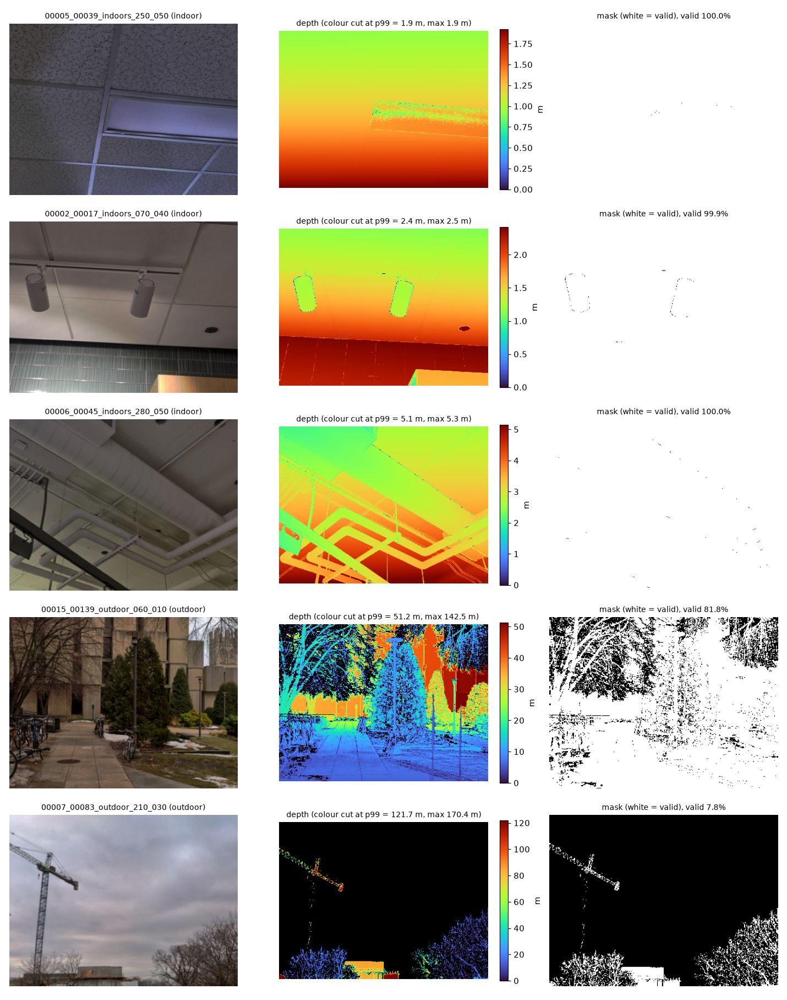

**Depth and invalid-pixel distribution (Table 1, Figures 2–3).** Statistics are over all valid pixels per split and domain; *invalid %* is the per-image mean.

**Table 1.** Depth distribution and invalid-pixel rate per split.

| Split | Domain | Images | p5 (m) | Median (m) | p95 (m) | p99 (m) | Mean invalid % |
| :--- | :--- | ---: | ---: | ---: | ---: | ---: | ---: |
| train | indoor | 2,606 | 1.0 | 2.6 | 9.0 | 20.2 | 0.8 |
| train | outdoor | 2,389 | 1.2 | 6.3 | 37.6 | 74.8 | 31.4 |
| val | indoor | 700 | 0.6 | 1.3 | 3.5 | 6.4 | 0.2 |
| val | outdoor | 400 | 1.4 | 7.1 | 32.5 | 51.4 | 47.4 |
| test | indoor | 700 | 0.8 | 1.8 | 5.0 | 7.5 | 0.2 |
| test | outdoor | 400 | 2.1 | 8.3 | 46.3 | 84.6 | 33.2 |

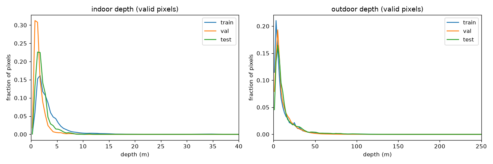

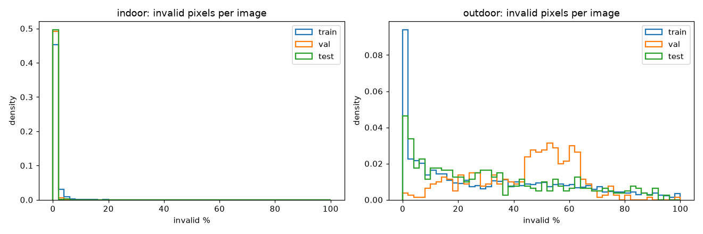

Key observations:
- **Depth range differs by an order of magnitude** between domains, which motivates reporting indoor and outdoor separately in every table.
- **Validation indoor scene is unusually close** (median 1.3 m vs 2.6 m in train). A metric model that learns the training depth prior will over-estimate depth there (observed in §3.2).
- **Outliers:** only 0.0085 % of indoor valid pixels exceed 50 m and 0.0051 % of outdoor valid pixels exceed 200 m; these are treated as sensor noise and masked. Readings below 0.6 m (the scanner's minimum range, ≈ 0.3 % of outdoor pixels, mostly leaves and glass) are also masked.
- **Camera tilt (Figure 4):** every scene contains vertical codes 000–050; 26–42 % of images per scene look upward (code ≥ 040), which increases the sky share in outdoor images.

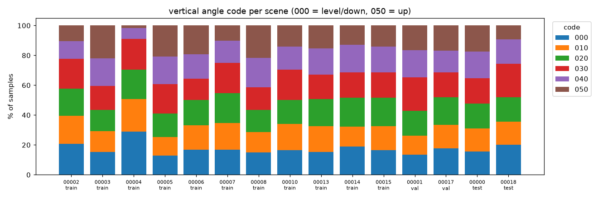

### 1.4 Data Splitting
- **Split unit: scene.** DIODE scans of the same scene share geometry and viewpoints; all images of a scene go to exactly one split. Overlap between splits was verified to be 0 scenes (`proposal/scenes_used.csv`).
- **Custom split** (DIODE has no public test labels): ≈ 70 / 15 / 15 % by images with seed 42.

**Table 2.** Scene-level split.

| Split | Indoor scenes (images) | Outdoor scenes (images) | Total |
| :--- | :--- | :--- | ---: |
| train | 00002 (700), 00003 (466), 00004 (400), 00005 (340), 00006 (700) | 00007 (389), 00008, 00010, 00013, 00014, 00015 (400 each) | 4,995 (2,606 / 2,389) |
| val | 00001 (700) | 00017 (400) | 1,100 (700 / 400) |
| test | 00000 (700) | 00018 (400) | 1,100 (700 / 400) |

- **Subset selection rule:** at most 700 images per indoor scene and 400 per outdoor scene, sampled with seed 42, so that no single large scene dominates. No stratification beyond the indoor/outdoor balance per split.
- **Leakage prevention:** scene-disjoint splits; checkpoint selection uses only the validation split; the test split was evaluated once per final checkpoint, after all design decisions were fixed.

### 1.5 Preprocessing
- **Resize:** 1024 × 768 → 384 × 288. RGB with bilinear interpolation; depth and mask with **nearest neighbour**. DIODE encodes invalid depth as 0, so bilinear resizing would blend zeros into valid boundary pixels. We verified the stored subset: mask values are strictly {0, 1} and the border-to-interior depth median ratio is 0.81–1.03 (vs < 0.5 under bilinear blending).
- **Validity mask:** `valid = mask > 0 ∧ finite ∧ 0.6 m ≤ depth ≤ cap`, with cap 50 m indoor and 200 m outdoor. Invalid pixels are set to 0 and excluded from loss and metrics.
- **Normalisation:** RGB scaled to [0, 1] and normalised with ImageNet mean/std; depth kept in metres.
- **Augmentation:** synchronous random horizontal flip ($p = 0.5$) of RGB, depth and mask, training only. No colour or scale augmentation (scale changes would alter metric depth).
- **Tensor shapes:** RGB $(B, 3, 288, 384)$ float32, depth $(B, 1, 288, 384)$ float32, mask $(B, 1, 288, 384)$ in {0, 1}; $B = 8$. Figure 5 shows one real training batch after preprocessing.

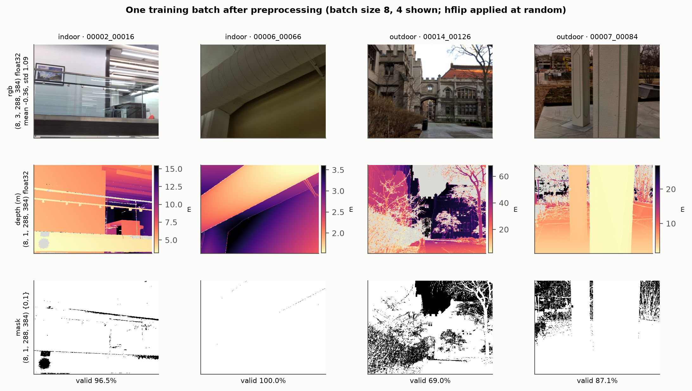

---

## Part 2 — Methodology

### 2.1 Pipeline Overview

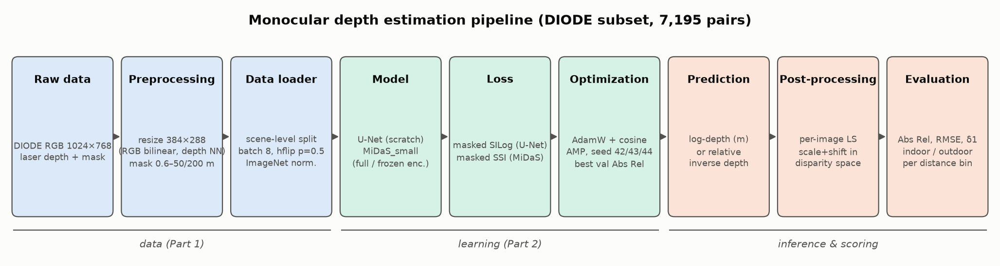

1. **Raw data:** DIODE RGB (1024 × 768), laser depth and validity mask.
2. **Preprocessing:** resize to 384 × 288 (nearest neighbour for depth/mask), range masking 0.6–50 m / 0.6–200 m.
3. **Data loader:** scene-level splits, batch 8, random horizontal flip, ImageNet normalisation, seeded workers.
4. **Model:** U-Net trained from scratch (metric log-depth) or MiDaS_small (relative inverse depth), the latter either fully fine-tuned or with a frozen encoder.
5. **Loss:** masked SILog (U-Net) or masked scale-and-shift-invariant loss (MiDaS).
6. **Optimisation:** AdamW + cosine schedule, mixed precision; checkpoint = epoch with lowest overall val Abs Rel.
7. **Prediction:** forward pass at 384 × 288.
8. **Post-processing:** per-image least-squares scale and shift in disparity space (applied to every model for the main comparison).
9. **Evaluation:** Abs Rel, RMSE, δ1 per image on valid pixels; reported overall, per domain, and per distance bin.

### 2.2 Baseline and Main Methods

#### 2.2.1 Baseline — U-Net trained from scratch
- **Architecture:** 4-level encoder–decoder; each level is two (Conv 3 × 3 → BatchNorm → ReLU) blocks with channels 32 → 64 → 128 → 256 → 512 (bottleneck at 1/16 resolution, 18 × 24); 2 × 2 max-pooling down, 2 × 2 transposed convolution up, skip concatenation at each level; 1 × 1 output head.
- **Output:** log-depth $z$; depth $= \exp(\mathrm{clamp}(z, -7, 6))$ (≈ 1 mm to 400 m). The head bias is initialised to 1.6 (≈ 5 m). An exponential instead of ReLU keeps gradients alive for all pixels.
- **Loss — masked SILog** (Eigen et al., 2014), with $d_p = \log \hat{D}_p - \log D^\ast_p$ over the $n$ valid pixels:
  $$\mathcal{L}_{\text{SILog}} = \frac{1}{n}\sum_p d_p^2 - \lambda \Big(\frac{1}{n}\sum_p d_p\Big)^2, \quad \lambda = 0.5.$$
  The log is computed in float32 even under AMP.
- **Parameters:** 7.76 M (all trainable).
- **Strengths / limits:** predicts metric depth directly and is fast (3.3 ms/image), but has no prior knowledge of scene geometry and only 11 training scenes to learn it from.

#### 2.2.2 Pretrained model — MiDaS_small
- **Architecture:** EfficientNet-Lite3 encoder pretrained on ImageNet and then trained by the MiDaS authors on a large mixture of depth datasets; RefineNet-style multi-scale fusion decoder. Loaded from `torch.hub` (`intel-isl/MiDaS`, `MiDaS_small`).
- **Output:** relative inverse depth (disparity), defined only up to an unknown scale and shift.
- **Parameters:** 21.32 M total; with a frozen encoder 14.90 M remain trainable (encoder 6.42 M frozen).
- **Fine-tuning loss — masked scale-and-shift-invariant (SSI) loss** (Ranftl et al., 2020). Prediction $\hat{u}$ and target disparity $u^\ast = 1/D^\ast$ are each normalised per image on valid pixels,
  $$\tilde{x} = \frac{x - \mathrm{median}(x)}{\frac{1}{n}\sum_p |x_p - \mathrm{median}(x)|}, \qquad \mathcal{L}_{\text{SSI}} = \frac{1}{n}\sum_p \big|\tilde{\hat{u}}_p - \tilde{u}^\ast_p\big|,$$
  then averaged over the images of the batch (images with < 10 valid pixels are skipped).
- **Strengths / limits:** strong geometric prior from large-scale pretraining; cannot output metric depth without alignment.

#### 2.2.3 Fine-tuning protocol
- **Zero-shot:** pretrained weights, no training on DIODE.
- **Full fine-tune:** all 21.32 M parameters trained.
- **Frozen encoder:** encoder weights have `requires_grad = False` **and** encoder BatchNorm layers stay in eval mode (running statistics are not updated); only the decoder trains.
- Both fine-tuning variants use identical hyper-parameters (§2.3), so the encoder freezing is the only changed factor.

#### 2.2.4 Alignment for evaluation (post-processing)
For every image and every model we fit a least-squares scale $s$ and shift $t$ in disparity space on valid pixels,
$$ (s, t) = \arg\min_{s,t} \sum_{p \in \text{valid}} \big(s\,\hat{u}_p + t - 1/D^\ast_p\big)^2, \qquad \hat{D} = \frac{1}{\mathrm{clip}(s\,\hat{u} + t,\ 1/\text{cap},\ 10^3)}.$$
The U-Net's metric output is converted to disparity $1/\hat{D}$ before alignment so that all models are compared under the same protocol; its raw metric results are reported separately. Alignment uses ground truth, so aligned numbers measure *relative* depth quality (structure), not absolute scale.

#### 2.2.5 Metrics
Per image on valid pixels, then averaged over images ($\hat{D}$ clipped into the valid range instead of dropping bad pixels):
- **Abs Rel** (primary): $\frac{1}{n}\sum_p |\hat{D}_p - D^\ast_p| / D^\ast_p$ ↓
- **RMSE (m):** $\sqrt{\frac{1}{n}\sum_p (\hat{D}_p - D^\ast_p)^2}$ ↓
- **δ1:** share of pixels with $\max(\hat{D}_p/D^\ast_p, D^\ast_p/\hat{D}_p) < 1.25$ ↑

Sanity checks (`tests/test_metrics.py`): feeding GT gives Abs Rel = RMSE = 0 and δ1 = 100 %; a disparity map scaled and shifted from $1/D^\ast$ is recovered exactly by the alignment.

#### 2.2.6 Self-implemented vs library code
- **Self-implemented:** subset builder and scene split, Dataset/DataLoader with masking, U-Net, SILog and SSI losses, least-squares alignment, metrics and distance-bin tracker, trainer (AMP, checkpointing, time budget, VRAM logging), evaluation and all diagnostic/figure scripts, unit tests.
- **Libraries:** PyTorch 2.14 (layers, AdamW, cosine scheduler, AMP), `torch.hub` `intel-isl/MiDaS` (MiDaS_small architecture and weights) with `timm` / `gen-efficientnet-pytorch` (EfficientNet-Lite3 backbone), OpenCV (resizing in subset creation), NumPy, Pillow, Matplotlib, PyYAML.

### 2.3 Training Setup
**Table 3.** Training configuration (`configs/base.yaml` + one YAML per experiment).

| Setting | U-Net baseline | MiDaS full FT | MiDaS frozen encoder |
| :--- | :--- | :--- | :--- |
| Optimizer | AdamW, wd 1e-4 | AdamW, wd 1e-4 | AdamW, wd 1e-4 |
| Learning rate | 3e-4 | 5e-5 | 5e-5 |
| Scheduler | cosine to 0 over the run | cosine | cosine |
| Batch size | 8 | 8 | 8 |
| Epochs | max 40, 60-min time budget | 10 | 10 |
| Loss | masked SILog (λ = 0.5) | masked SSI | masked SSI |
| Regularisation | weight decay, hflip | weight decay, hflip, pretrained init | weight decay, hflip, frozen encoder + BN |
| Early stopping | none (time budget only) | none | none |
| Checkpoint rule | lowest overall val Abs Rel | same | same |
| Mixed precision | AMP fp16 (loss in fp32) | AMP | AMP |
| Seeds | 42, 43, 44 | 42, 43, 44 | 42, 43, 44 |

- **Determinism:** Python/NumPy/PyTorch seeds and seeded DataLoader workers, `cudnn.deterministic = True`, `benchmark = False`, `torch.use_deterministic_algorithms(True, warn_only=True)`. Two smoke runs of the same config produced identical losses and metrics.
- **Hardware / software:** NVIDIA GeForce RTX 4060 Laptop GPU (8 GB); Python 3.14.8, PyTorch 2.14.0 + CUDA 13.0, cuDNN 9.24, timm 1.0.30, NumPy 2.5.3.
- **Training time (seed 42):** U-Net 52.0 min (40 epochs, 78 s/epoch); MiDaS full FT 35.6 min (214 s/epoch); frozen encoder 30.1 min (180 s/epoch).
- **Hyper-parameter selection:** no grid search (compute budget). MiDaS lr 5e-5 is the usual fine-tuning range for a pretrained depth network; the U-Net lr 3e-4 is the standard Adam range for training from scratch. Ten MiDaS epochs were chosen from the M1 compute estimate; val Abs Rel had flattened by epoch 7–9 (Figure 7).
- **Compute estimate vs actual:** the M1 benchmark predicted ≈ 1.0 min/epoch for MiDaS_small (AMP, L1 placeholder loss, no validation). The actual 3.6 min/epoch is slower because of deterministic cuDNN, the per-image SSI loss and a full aligned validation pass every epoch.

### 2.4 Experimental Design
**Table 4.** Experiments.

| # | Experiment | Hypothesis | Changed factor | Fixed factors | Metrics | Decision criterion |
| :--- | :--- | :--- | :--- | :--- | :--- | :--- |
| E1 | Baseline vs pretrained | Large-scale depth pretraining gives better structure than training from scratch on 11 scenes | Model (U-Net scratch vs MiDaS) | data, split, alignment, metrics | aligned Abs Rel, RMSE, δ1 (val + test), compute | lower test Abs Rel in both domains |
| E2 | Zero-shot vs fine-tuned | Fine-tuning on DIODE adapts MiDaS to laser GT and these scenes | Training on DIODE (none vs full FT) | model, data, alignment | same | lower test Abs Rel than zero-shot in both domains |
| **E3 (controlled, main ablation)** | **Full FT vs frozen encoder** | Updating the encoder lets features adapt, so full FT reaches lower val Abs Rel | `freeze_encoder` only | data, split, SSI loss, AdamW lr 5e-5 wd 1e-4, cosine, batch 8, 10 epochs, AMP, checkpoint rule, alignment | overall val Abs Rel (primary), test Abs Rel, RMSE, δ1, train time, VRAM | full FT is better only if its mean val Abs Rel is lower than frozen by more than the seed-to-seed std (3 seeds: 42, 43, 44); otherwise the cheaper frozen setup is preferred |
| E4 | Evaluation-protocol ablations | (a) Outdoor error is partly a GT-boundary artefact; (b) a robust median/MAD alignment is better than least squares on outdoor scenes | (a) valid-mask erosion 0/1/2 px; (b) LS vs median/MAD alignment | trained checkpoints | Abs Rel per domain | (a) supported if outdoor Abs Rel drops much more than indoor; (b) adopt median alignment only if lower Abs Rel on both domains |

---

## Part 3 — Implementation Results

### 3.1 Training Behaviour

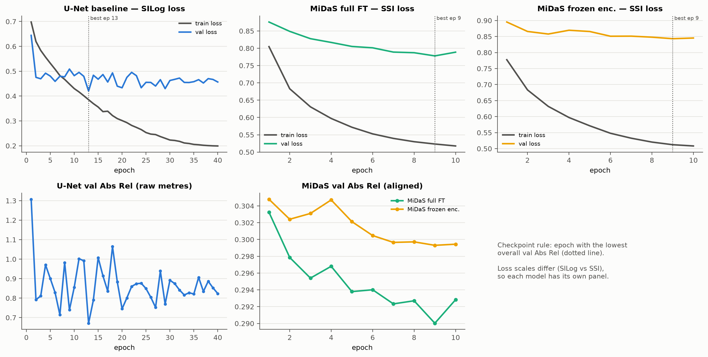

- **U-Net:** training loss falls steadily from 0.70 to 0.20 over 40 epochs while validation loss plateaus after epoch 2 and oscillates between 0.42 and 0.51. Raw val Abs Rel is very noisy (0.67–1.31) and is lowest at **epoch 13 of 40**, so the baseline overfits the 11 training scenes; the late epochs are not used.
- **MiDaS full FT:** validation loss decreases monotonically until epoch 9 (0.778) and rises slightly at epoch 10; val Abs Rel 0.303 → 0.290 (best epoch 9).
- **MiDaS frozen encoder:** validation loss barely moves (0.896 → 0.843) and val Abs Rel improves only 0.305 → 0.299 (best epoch 9). With the encoder fixed, the decoder alone has limited room to change the representation.
- **Implementation issues found and fixed:** (i) bilinear depth resizing in the first subset contaminated valid boundary pixels with zero depth → the subset was rebuilt with nearest-neighbour resizing (M1); (ii) sub-0.6 m outdoor readings pushed zero-shot outdoor Abs Rel above 1 → depths below the scanner's minimum range are masked (M2).
- **Design safeguards:** the U-Net predicts log-depth with an exponential output because a ReLU would give zero gradient to pixels stuck at 0; the SILog logarithm is computed in fp32 because fp16 under AMP loses precision; in the frozen-encoder variant the encoder's BatchNorm layers are kept in eval mode so their running statistics do not drift.

### 3.2 Quantitative Results

**Table 5.** Main results, seed 42 (aligned unless stated). Val = scenes 00001 (indoor) + 00017 (outdoor); test = 00000 + 00018, 700 indoor + 400 outdoor images each.

| Split | Model | Overall Abs Rel ↓ | Overall RMSE ↓ | Overall δ1 ↑ | Indoor Abs Rel ↓ | Indoor δ1 ↑ | Outdoor Abs Rel ↓ | Outdoor RMSE ↓ | Outdoor δ1 ↑ |
| :--- | :--- | ---: | ---: | ---: | ---: | ---: | ---: | ---: | ---: |
| val | U-Net (raw metres) | 0.671 | 4.77 | 31.9 % | 0.606 | 38.1 % | 0.785 | 11.26 | 21.2 % |
| val | U-Net (aligned) | 0.338 | 4.43 | 58.0 % | 0.165 | 77.4 % | 0.641 | 11.21 | 24.0 % |
| val | MiDaS zero-shot | 0.321 | 4.60 | 63.2 % | 0.132 | 83.9 % | 0.651 | 11.79 | 26.9 % |
| val | MiDaS full FT | **0.290** | 4.39 | **68.1 %** | **0.091** | **92.4 %** | 0.637 | 11.26 | 25.6 % |
| val | MiDaS frozen enc. | 0.299 | **4.34** | 66.3 % | 0.106 | 89.6 % | **0.637** | **11.11** | 25.5 % |
| test | U-Net (raw metres) | 0.561 | 6.18 | 25.7 % | 0.436 | 28.8 % | 0.780 | 14.93 | 20.2 % |
| test | U-Net (aligned) | 0.305 | 5.35 | 59.0 % | 0.177 | 73.1 % | 0.531 | 13.48 | 34.5 % |
| test | MiDaS zero-shot | 0.271 | 5.11 | 67.8 % | 0.126 | 83.9 % | 0.524 | 13.17 | 39.5 % |
| test | MiDaS full FT | **0.232** | 4.52 | **72.7 %** | **0.096** | **89.8 %** | 0.470 | 11.63 | 42.9 % |
| test | MiDaS frozen enc. | 0.233 | **4.44** | 72.6 % | 0.099 | 89.5 % | **0.467** | **11.42** | **43.0 %** |

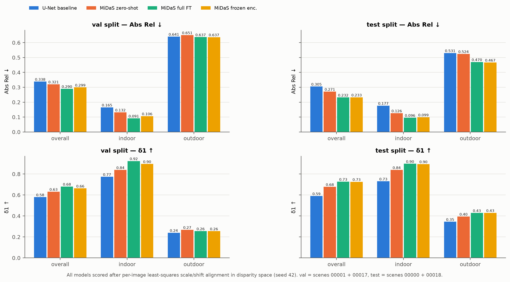

**Table 5b.** U-Net baseline over three seeds (42 / 43 / 44), Abs Rel mean ± sample std. Best val epochs 13 / 16 / 19 of 40; training 52.0 / 50.7 / 50.9 min.

| Split | Mode | Overall Abs Rel | Overall δ1 | Indoor Abs Rel | Outdoor Abs Rel |
| :--- | :--- | :---: | :---: | :---: | :---: |
| val | raw metres | 0.653 ± 0.017 | 29.2 ± 3.1 % | 0.608 ± 0.009 | 0.730 ± 0.048 |
| val | aligned | 0.341 ± 0.004 | 57.5 ± 1.0 % | 0.169 ± 0.007 | 0.642 ± 0.002 |
| test | raw metres | 0.554 ± 0.019 | 26.2 ± 0.8 % | 0.459 ± 0.044 | 0.721 ± 0.055 |
| test | aligned | 0.306 ± 0.005 | 59.0 ± 1.0 % | 0.177 ± 0.005 | 0.531 ± 0.004 |

*The seed-42 numbers in Table 5 are representative: aligned test Abs Rel varies by only ± 0.005 across seeds, far less than the 0.035 gap to MiDaS zero-shot. Raw metric error varies about 4× more than aligned error, mainly from the global scale the network learns.*

**Table 6.** Controlled experiment E3 over three seeds (aligned Abs Rel, mean ± sample std).

| Split | Domain | Full FT (seed 42 / 43 / 44) | Full FT mean ± std | Frozen (seed 42 / 43 / 44) | Frozen mean ± std | Gap (frozen − full) |
| :--- | :--- | :---: | :---: | :---: | :---: | :---: |
| val | **overall** | 0.2900 / 0.2883 / 0.2898 | **0.2893 ± 0.0010** | 0.2993 / 0.3001 / 0.2989 | 0.2994 ± 0.0006 | **+0.0101** |
| val | indoor | 0.0915 / 0.0914 / 0.0897 | 0.0909 ± 0.0010 | 0.1064 / 0.1048 / 0.1048 | 0.1053 ± 0.0009 | +0.0144 |
| val | outdoor | 0.6375 / 0.6327 / 0.6398 | 0.6367 ± 0.0036 | 0.6369 / 0.6420 / 0.6385 | 0.6392 ± 0.0026 | +0.0025 |
| test | **overall** | 0.2321 / 0.2291 / 0.2319 | **0.2310 ± 0.0017** | 0.2328 / 0.2340 / 0.2333 | 0.2334 ± 0.0006 | **+0.0024** |
| test | indoor | 0.0961 / 0.0935 / 0.0931 | 0.0943 ± 0.0016 | 0.0992 / 0.0995 / 0.0995 | 0.0994 ± 0.0001 | +0.0051 |
| test | outdoor | 0.4701 / 0.4664 / 0.4746 | 0.4704 ± 0.0041 | 0.4667 / 0.4694 / 0.4676 | 0.4679 ± 0.0014 | −0.0025 |

*Sample std over 3 seeds. Training of seeds 43 / 44: full FT 36.0 / 33.8 min (best epoch 6 / 10), frozen 29.6 / 29.5 min (best epoch 10 / 7); peak VRAM identical to seed 42 (2.42 GB full, 1.17 GB frozen).*

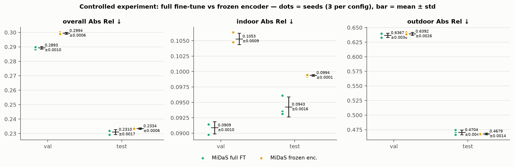

**Table 7.** Compute cost (seed 42). Inference is model-only, batch 1, AMP, 100 images after 10 warm-up passes; whole-split evaluation including alignment takes ≈ 13–14 s for 1,100 images.

| Model | Params (M) | Trainable (M) | Epochs (best) | Train time (min) | s / epoch | Peak train VRAM (GB) | Inference (ms/img) |
| :--- | ---: | ---: | :---: | ---: | ---: | ---: | ---: |
| U-Net baseline | 7.76 | 7.76 | 40 (13) | 52.0 | 78 | 1.40 | 3.3 |
| MiDaS zero-shot | 21.32 | 0 | – | – | – | – | 9.4 – 9.9 |
| MiDaS full FT | 21.32 | 21.32 | 10 (9) | 35.6 | 214 | 2.42 | 10.1 – 10.4 |
| MiDaS frozen enc. | 21.32 | 14.90 | 10 (9) | 30.1 | 180 | 1.17 | 10.8 – 11.3 |

*Ranges are the val and test measurements. The three MiDaS variants run the same network at inference, so their 9.4–11.3 ms spread is timing noise on a laptop GPU, not a real difference.*

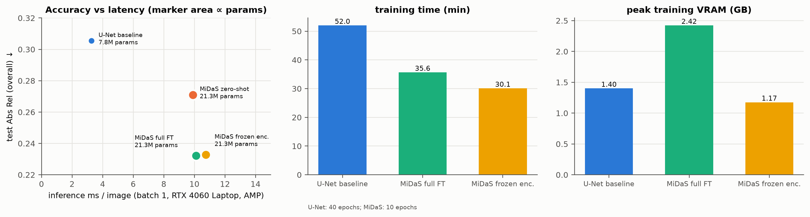

### 3.3 Qualitative Results

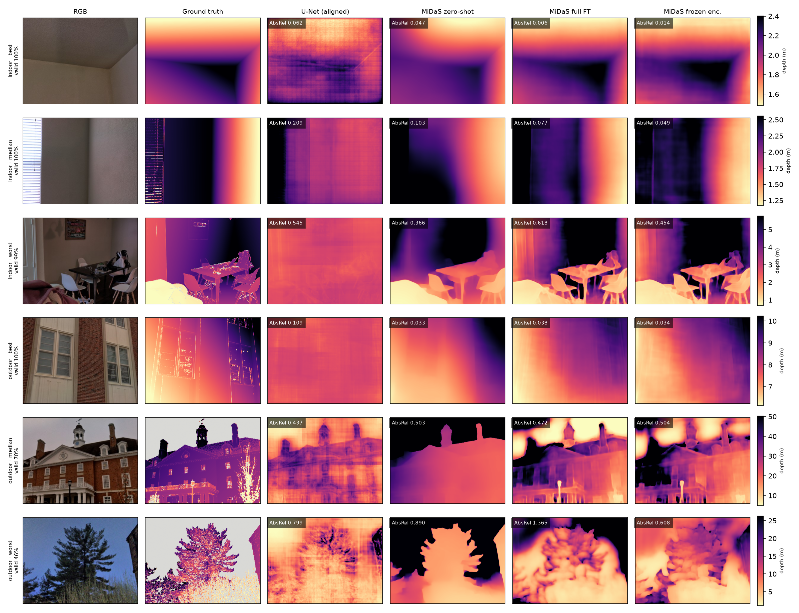

- **Correct, easy cases (rows 1, 4):** planar walls, ceilings and façades. All MiDaS variants reproduce the GT gradient (Abs Rel 0.006–0.047); the U-Net gets the global trend but shows a grid/checkerboard texture from transposed-convolution upsampling.
- **Difficult but correct (row 2, row 5):** a window with blinds and a building façade with sky. Full FT and frozen keep the wall-to-window depth step that zero-shot smooths over; on the façade, fine-tuned models recover the roof line and windows, while zero-shot collapses the building to a near-constant depth (Abs Rel 0.503 vs 0.472).
- **Failures (rows 3, 6):** the worst indoor image (a cluttered room with chairs and a blanket at < 1 m) and the worst outdoor image (a pine tree against sky, 46 % valid pixels). Full FT produces sharper object outlines than zero-shot but places the near blanket and the tree crown at the wrong relative depth, giving Abs Rel 0.618 and 1.365; the frozen encoder is better on both (0.454, 0.608).

### 3.4 Comparison and Discussion
- **Pretrained vs scratch (E1, supported).** On test, MiDaS zero-shot already beats the aligned U-Net overall (0.271 vs 0.305, −11 %) and indoors (0.126 vs 0.177, −29 %) without seeing DIODE; outdoors the two are tied (0.524 vs 0.531). The U-Net costs 2.7× fewer parameters and is 3× faster (3.3 vs ≈ 10 ms) but needs 52 min of training and still overfits (§3.1). Its **raw metric** error (test 0.561, val 0.671) is about twice its aligned error: most of the raw error is a global scale error, consistent with the val indoor scene being twice as close as the training rooms (§1.3).
- **Fine-tuning vs zero-shot (E2, supported).** Full FT lowers test Abs Rel from 0.271 to 0.232 (−14 %): indoor 0.126 → 0.096 (−24 %, δ1 83.9 → 89.8 %) and outdoor 0.524 → 0.470 (−10 %). On val the outdoor gain is only 0.651 → 0.637; the val outdoor scene (a forest, 47 % invalid pixels) is much harder than the other outdoor scenes (§3.5, E-1).
- **Full FT vs frozen encoder (E3, controlled).** Over three seeds, full fine-tuning has lower **val** Abs Rel (0.2893 ± 0.0010 vs 0.2994 ± 0.0006). The gap of 0.0101 is about 10× the larger seed std, and every full-FT seed beats every frozen seed, so by the pre-registered decision criterion **full FT is better on val, and the hypothesis is supported**. The gain is entirely indoor (0.0909 vs 0.1053, −14 %); outdoors the two are within one std (0.637 vs 0.639). On the untouched **test** split the gap shrinks to 0.0024 (0.2310 vs 0.2334), about 1.4× the larger std: still in favour of full FT indoors (0.0943 vs 0.0994, all three seeds) and slightly worse outdoors (0.470 vs 0.468, within one std). Updating the encoder therefore helps mainly in indoor scenes, where DIODE's close-range laser geometry differs most from MiDaS's training data; outdoors the frozen ImageNet/MiDaS features are already as good as what 10 epochs of encoder updates can reach. Three seeds give only a rough std estimate, so the test-split conclusion is weak.
- **Accuracy–cost trade-off.** The frozen encoder uses **52 % less peak VRAM** (1.17 vs 2.42 GB) and trains **15 % faster** (30.1 vs 35.6 min) for the same inference cost. The U-Net is the only option under ≈ 5 ms/image, at +31 % test Abs Rel relative to fine-tuned MiDaS.
- **Hypotheses not yet supported / conclusions we cannot draw.** With one val and one test scene per domain, the outdoor ranking depends on scene content; the val→test differences (e.g. outdoor 0.637 → 0.470 for full FT) are larger than any difference between the MiDaS variants. Aligned numbers measure relative depth only; none of the MiDaS variants produces metric depth on its own.

### 3.5 Error Analysis
Numbers in this section are on the **test split** for MiDaS full FT unless stated; per-image values are produced by `scripts/report/per_image_test.py` (not stored in git).

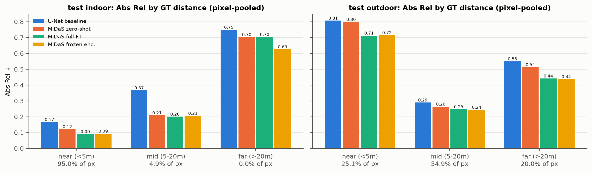

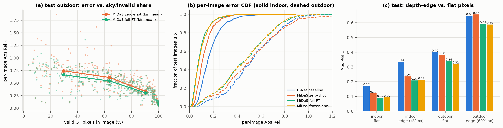

**Table 8.** Error taxonomy.

| Group | Description | Frequency / rate | Examples | Hypothesised cause | Improvement ideas |
| :--- | :--- | :--- | :--- | :--- | :--- |
| **E-1 Sky / sparse-GT outdoor images** | Outdoor images whose valid pixels are fragmented by sky and foliage have far higher error | Spearman ρ = −0.75 between per-image Abs Rel and valid share. Images with < 50 % valid pixels: 115 / 400 (29 %), mean Abs Rel **0.664**; images with > 75 % valid: 180 / 400, mean **0.305** (Fig. 13a) | Fig. 11 row 6 (tree, 46 % valid, Abs Rel 1.365) | Remaining valid pixels are mostly thin branches next to sky, where laser returns are noisy; the global alignment is fitted on few, scattered pixels | Sky segmentation or confidence-weighted loss; erode boundary pixels in training targets; more outdoor scenes |
| **E-2 Depth discontinuities and thin structures** | Pixels next to a depth jump (> 10 % relative) or an invalid pixel | Indoor: 4.0 % of pixels, Abs Rel **0.208 vs 0.090** on flat pixels (2.3×). Outdoor: 60 % of pixels are edge pixels, **0.591 vs 0.339** (Fig. 13c) | Chair legs and table edges in Fig. 11 row 3; branches in row 6 | All models output smooth maps at 384 × 288; GT at edges mixes foreground and background returns ("edge bleeding") | Higher input resolution; gradient-matching loss (as in MiDaS training); boundary-aware evaluation |
| **E-3 Outdoor range compression** | After alignment, near outdoor ground is predicted too far and far trees/buildings too close | Outdoor near (< 5 m, 25 % of px): Abs Rel **0.712**; mid (5–20 m, 55 %): **0.248**; far (> 20 m, 20 %): **0.441**, δ1 only 23 % (Fig. 12) | Foreground grass in Fig. 11 row 6 | A single scale/shift cannot fit a prediction whose depth ordering is only weakly correlated with GT (rank correlation 0.14 on val scene 00017 vs ≈ 0.45 on other outdoor scenes); errors are pulled toward the mid range | Train with a metric head or per-region alignment; more far-range training data |
| **E-4 Indoor long views (doorways, corridors)** | Few indoor pixels beyond 5 m are poorly predicted | 4.9 % of indoor test pixels are 5–20 m: Abs Rel **0.201** vs 0.090 for < 5 m. Level-camera images (tilt 000, n = 110) mean **0.128** vs 0.078–0.082 for tilts 030–050 | Corridors and open doors in scene 00000 | Training rooms are close-range (median 2.6 m); level views include more distant corridor depth | Balance training images by depth range or add corridor-heavy scenes |
| **E-5 U-Net global scale error and artefacts** | Raw U-Net output has the wrong absolute scale; checkerboard texture | Raw → aligned test Abs Rel **0.561 → 0.305**; indoor 0.436 → 0.177 | Fig. 11 column 3 (grid pattern) | Metric scale learned from 11 scenes does not transfer to closer/farther unseen rooms; transposed convolutions | Pretrained encoder; bilinear upsampling + conv; scale augmentation with camera intrinsics |
| **E-6 Fine-tuning regressions** | Some images get worse after fine-tuning | Full FT is worse than zero-shot on **25.9 %** of indoor and **24.8 %** of outdoor test images | Fig. 11 rows 3 and 6 (0.618 vs 0.366; 1.365 vs 0.890) | Overfitting the decoder to 11 training scenes; SSI loss ignores how bad individual outliers are | Fewer epochs or lower lr for the decoder; mix in original MiDaS training data; model averaging over seeds |

**Ablation E4a — boundary-mask erosion (val).** Eroding the valid mask by 1 / 2 px (8-neighbourhood) removes pixels bordering invalid regions.

| Model | Outdoor 0 px | 1 px | 2 px | Indoor 0 px → 2 px |
| :--- | ---: | ---: | ---: | :---: |
| U-Net (aligned) | 0.641 | 0.456 | 0.435 | 0.165 → 0.163 |
| MiDaS zero-shot | 0.651 | 0.446 | 0.422 | 0.132 → 0.129 |
| MiDaS full FT | 0.637 | 0.432 | **0.403** | 0.091 → 0.089 |
| MiDaS frozen enc. | 0.637 | 0.432 | 0.405 | 0.106 → 0.104 |

Outdoor Abs Rel drops by 29–37 % while indoor changes by ≤ 0.003, so **a large part of the outdoor error sits on one- or two-pixel boundary bands** where the laser ground truth itself is unreliable (hypothesis E4a supported). Even after erosion, outdoor error is ≈ 4.5× indoor (0.403 vs 0.089), so outdoor scenes remain harder, and the model ranking (full FT < frozen < zero-shot < U-Net) becomes clearer.

**Ablation E4b — alignment method.** Replacing least squares with a robust median / mean-absolute-deviation alignment makes every model worse (test, full FT: indoor 0.096 → 0.204; outdoor 0.470 → 2.001). In outdoor scenes the disparity distribution is dominated by near-zero values of far pixels, so matching medians and spreads and then inverting amplifies errors in the far range. Hypothesis E4b is rejected; least squares is kept. A separate check (`scripts/report/outdoor_check.py`) found that log-space alignment is also worse (val outdoor 0.89), and that MiDaS zero-shot scores 0.36–0.55 on the six training outdoor scenes vs 0.68 on val scene 00017, confirming the high outdoor val error is a property of that scene rather than a pipeline bug.

### 3.6 Limitations, Generalisation and Future Work
- **Data:** val and test each contain one indoor and one outdoor scene, so per-domain numbers reflect two specific scenes; the 0.637 (val) vs 0.470 (test) outdoor gap for the same checkpoint shows how strongly results depend on scene choice. All splits come from DIODE's training partition, so numbers are not comparable to the public benchmark.
- **Ground truth:** laser drop-outs and edge bleeding (§3.5, E-1, E-2, E4a) put a floor under outdoor error that no model removes.
- **Method:** aligned evaluation uses GT to fix scale and shift; it measures relative structure, not deployable metric depth. Only one pretrained backbone (MiDaS_small) was studied due to the 8 GB laptop GPU.
- **Experimental:** checkpoints are selected on val; to limit optimism, every main number is also reported on the untouched test split. The controlled experiment and the U-Net baseline use three seeds (42, 43, 44), so std estimates are still rough; Table 5 itself shows seed 42 only (zero-shot is deterministic and needs no seeds). Ten epochs may under-train the frozen variant (its seed-43 best epoch is the last one).
- **Resolution:** 384 × 288 inputs smooth thin branches and wires.
- **Future work:** a metric-depth head (or metric-depth pretrained models such as ZoeDepth / Depth Anything metric) to remove the alignment step; gradient-matching and edge-aware losses; sky masking; more outdoor scenes and cross-validation over scenes.

### 3.7 Conclusion (Answer to the Research Question)
*Does large-scale pretraining with a documented fine-tuning protocol beat a model trained from scratch for monocular depth on DIODE, and is updating the encoder worth its cost?*
Yes for pretraining: fine-tuned MiDaS_small reaches test Abs Rel 0.232 (δ1 72.7 %) against 0.305 (59.0 %) for the aligned U-Net and 0.271 for zero-shot MiDaS, with the largest gains indoors (0.096 vs 0.177). For the encoder question, updating the encoder is worth it by our decision criterion: over three seeds full fine-tuning beats the frozen encoder by 0.010 val Abs Rel (≈ 10× the seed std), almost entirely indoors. On test the advantage shrinks to 0.002 (≈ 1.4× std), so when memory is the constraint the frozen encoder is a reasonable choice: it gives up little accuracy for 52 % less peak VRAM and 15 % less training time. Outdoor scenes stay the main failure mode (test Abs Rel ≈ 0.47 for every MiDaS variant); erosion and per-image analysis show that a large part of this error comes from sparse, noisy laser ground truth at sky and foliage boundaries rather than from the models alone.

---

## Reproducibility
- **Code and commands:** `assignment2/README.md` (install, data preparation, train, evaluate); `bash run_all.sh` re-runs every experiment, diagnostic and figure.
- **Configs:** `configs/base.yaml` plus one YAML per experiment; each run writes its resolved `config.yaml`, `history.csv`, `train_summary.json`, `eval_val.json`, `eval_test.json` to `outputs/<run>/` (local run artefacts, not stored in git; regenerated by the commands in the README).
- **Figures:** `scripts/report/report_figures.py`, `scripts/report/per_image_test.py`, `scripts/report/edge_and_alignment_check.py`, `scripts/report/erode_check.py`.
- **Checkpoints:** not stored in git (U-Net ≈ 31 MB, MiDaS ≈ 86 MB each); recreated with the README commands (seeds 42, 43 and 44, deterministic settings).
- **Traceability:** every number in Tables 5–8 is regenerated from those run artefacts by re-running the README commands at the commit tagged `a2-m3-final` (seeds and configs fixed).

---

## AI Usage Disclosure (Handbook Section 5.2)

The group used generative AI tools in this assignment. The detailed, per-entry log with all nine mandatory fields is in [`assignment2/AI_USAGE.md`](https://github.com/THVKhang/ALearning/blob/main/assignment2/AI_USAGE.md); this section summarises it.

### 1. Overview by member

| Member (ID) | Assignment 2 contributions | AI tools used | Verification role |
| :--- | :--- | :--- | :--- |
| **Trần Hoàng Vỹ Khang** (`2352502`) | Subset creation, scene-level split, data pipeline, seeds/configs, repository and checkpoints | Claude Code CLI (Claude Opus 5) — proposal compliance review, diagnosis of bilinear depth resampling (log entries 9–10) | Verified split disjointness, mask format and subset statistics |
| **Đỗ Đăng Khoa** (`2352554`) | Data verification, EDA, compute benchmark, visualisation, error analysis, assignment page, report | Antigravity AI Assistant (log entries 1–8, 13); Claude Code (Claude Opus 5.5) for M3 (entry 14 below) | Verified EDA numbers, figures and every number in this report against run outputs |
| **Dương Đăng Khoa** (`2352551`) | U-Net and MiDaS implementation, losses and metrics, controlled-experiment design | Antigravity AI Assistant (log entries 11–12) | Verified loss formulas, metric definitions and model shapes via unit tests |

### 2. Entries for M1 and M2 (summary)
- **Entries 1–8 (M1, Antigravity, Đỗ Đăng Khoa):** mask-format spot check, torch.hub non-interactive loading, depth visualisation scaling, EDA memory optimisation, seed isolation review, scene-split disjointness check, SILog formula check, page structure check. Verified against PyTorch/NumPy docs, the DIODE devkit and recomputed statistics.
- **Entries 9–10 (M1, Claude Code / Claude Opus 5, Trần Hoàng Vỹ Khang):** handbook §18/§21 compliance review of the proposal; diagnosis that bilinear depth resizing contaminated valid pixels, which led the group to rebuild the subset with nearest-neighbour resizing.
- **Entries 11–12 (M2, Antigravity, Dương Đăng Khoa):** review of the loss/metric engine and the U-Net training pipeline; verified with `tests/test_metrics.py`, `tests/test_models.py` and the original papers (Eigen et al., 2014; Ranftl et al., 2020).
- **Entry 13 (M2, Antigravity with a Claude model, Đỗ Đăng Khoa):** architecture and evaluation review (log-depth output, SSI loss, alignment, BatchNorm freezing, 0.6 m scanner minimum).

### 3. Entry 14 — M3 Final: compliance check, final runs, figures and report draft
- **Tool name and version/model:** Claude Code (VS Code extension), model Claude Opus 5.5.
- **Member who used it:** Đỗ Đăng Khoa (`2352554`).
- **Time or development stage:** 09 Nov 2026 — M3 Final.
- **Purpose & category:** handbook compliance check of the A2 deliverables; experiment orchestration; figure generation; report writing.
- **Affected sections / files:** `scripts/report/report_figures.py`, `scripts/report/per_image_test.py` (new, written by the tool); test-split evaluation and seed-43/44 runs launched by the tool with the group's existing `train.py` / `evaluate.py`; Figures 5–13; first draft of this report (all parts).
- **Representative prompts:** *"đọc kĩ mô tả bài tập lớn handbook-V2 và coi btl2 ass2 tôi đã đủ chưa"* (read the handbook carefully and check whether Assignment 2 is complete); *"tương tự ass1 bạn làm giúp tôi gen ảnh đồ ra rồi viết md report hoàn chỉnh dựa trên yêu cầu"* (as in Assignment 1, generate the figures and write a complete Markdown report following the requirements).
- **How AI output was edited and verified:** every number in the report was cross-checked against `outputs/*/eval_{val,test}.json`, `train_summary.json`, `history.csv` and `outputs/diagnostics/*`; every figure was inspected visually; the group edited the wording and confirmed the interpretations in §3.4–3.5. No model, loss, metric or training code was changed by the tool, and no result was produced outside the group's own runs.
- **Member responsible for final verification:** Đỗ Đăng Khoa (`2352554`), with review by Trần Hoàng Vỹ Khang (`2352502`) and Dương Đăng Khoa (`2352551`).
- **Sources used for verification:** saved run outputs, Course Handbook §3, §4, §17–23, MiDaS paper (Ranftl et al., 2020), DIODE paper (Vasiljevic et al., 2019).

---

## References
1. I. Vasiljevic, N. Kolkin, S. Zhang, R. Luo, H. Wang, F. Z. Dai, A. F. Daniele, M. Mostajabi, S. Basart, M. R. Walter, G. Shakhnarovich. *DIODE: A Dense Indoor and Outdoor DEpth Dataset.* arXiv:1908.00463, 2019.
2. R. Ranftl, K. Lasinger, D. Hafner, K. Schindler, V. Koltun. *Towards Robust Monocular Depth Estimation: Mixing Datasets for Zero-shot Cross-dataset Transfer.* IEEE TPAMI, 2020.
3. D. Eigen, C. Puhrsch, R. Fergus. *Depth Map Prediction from a Single Image using a Multi-Scale Deep Network.* NeurIPS, 2014.
4. O. Ronneberger, P. Fischer, T. Brox. *U-Net: Convolutional Networks for Biomedical Image Segmentation.* MICCAI, 2015.
5. M. Tan, Q. V. Le. *EfficientNet: Rethinking Model Scaling for Convolutional Neural Networks.* ICML, 2019.
