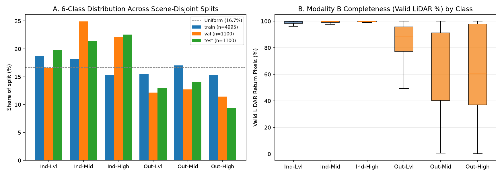
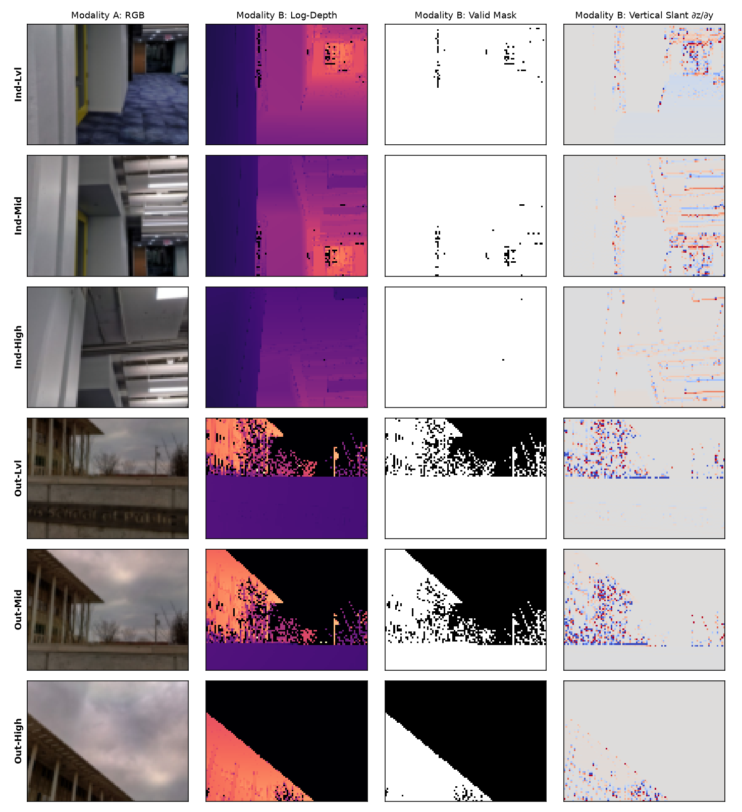
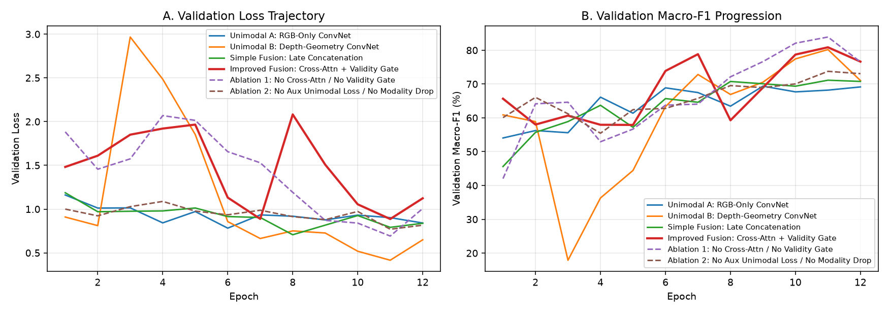
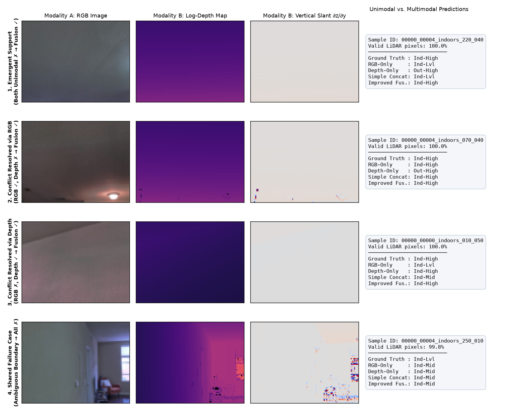
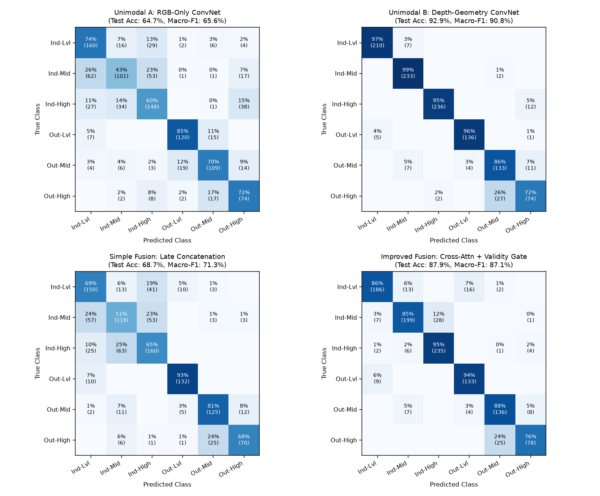

# CO3133 – Assignment 3 Technical Report: Multimodal Deep Learning

**Course:** Deep Learning and Its Applications (`CO3133`) — Semester `261`  
**Instructor:** Assoc. Prof. Lê Thành Sách  
**Group:** Nhóm CR7 (`Trần Hoàng Vỹ Khang – 2352502`, `Đỗ Đăng Khoa – 2352554`, `Dương Đăng Khoa – 2352551`)  
**Repository:** [https://github.com/THVKhang/ALearning/tree/main/assignment3](https://github.com/THVKhang/ALearning/tree/main/assignment3)  
**Assignment Page:** [https://thvkhang.github.io/ALearning/assignment3/](https://thvkhang.github.io/ALearning/assignment3/)

---

## Part 1: Problem Formulation, Multimodal Dataset & Exploratory Data Analysis

### 1.1 Problem Statement and Multimodal Motivation
Autonomous mobile robots, drones, and augmented-reality headsets operating with RGB-D sensors must continuously classify both the **semantic environment domain** (*Indoor* vs. *Outdoor*) and the **camera viewing-elevation regime** (*Level $0^\circ\text{–}10^\circ$*, *Mid-Elevated $20^\circ\text{–}30^\circ$*, *High-Elevated $40^\circ\text{–}50^\circ$*). Neither modality alone is sufficient across all operating regimes:
- **Modality A (RGB Visual Appearance, $x_{\text{rgb}} \in \mathbb{R}^{3 \times 72 \times 96}$):** Captures semantic textures (sky, foliage, brickwork vs. drywall, ceiling lamps, furniture) that separate *Indoor* from *Outdoor*, but struggles to estimate camera pitch on textureless indoor walls or dense tree canopies lacking a visible horizon.
- **Modality B (3D LiDAR Geometry & Validity Map, $x_{\text{depth}} \in \mathbb{R}^{3 \times 72 \times 96}$):** Encodes physical metric distance ($\tilde{d} = \frac{\log(1+d)}{\log(1+200)}\cdot m$), binary laser return validity ($m \in \{0,1\}$), and vertical log-depth slant gradient ($\partial_y \tilde{d}$), which directly measures surface orientation relative to the optical axis. However, in outdoor upward-looking views, **37.8%–37.9%** of laser pulses are lost to open sky or foliage edges ($m=0$), degrading depth-only reliability.

We formulate a **6-class single-label multimodal classification task** over $\{ \text{Indoor}, \text{Outdoor} \} \times \{ \text{Level } (0^\circ\text{–}10^\circ), \text{Mid } (20^\circ\text{–}30^\circ), \text{High } (40^\circ\text{–}50^\circ) \}$.

### 1.2 Dataset Provenance, Pair Validity, and Leakage-Free Scene Split (Handbook Sections 27 & 28)
- **Source & License:** **DIODE** (*Dense Indoor and Outdoor DEpth*, Vasiljevic et al., 2019), Kaggle Version 8 mirror, **MIT License**.
- **Cross-Modal Pair Validity (Section 28.1):** All **7,195 samples** pair an optical RGB photograph with a co-registered 3D FARO Focus S350 laser scan captured from the exact same physical mount and timestamp. Automated checking via `scripts/eda.py` confirmed **0 missing, corrupted, or mismatched files** across all 7,195 pairs.
- **Size Threshold Compliance (Section 28.2):** **7,195 paired samples** across **6 classes** (exceeding both the $\ge 5$ classes and $\ge 5,000$ paired-sample requirements).
- **Scene-Level Split to Prevent Leakage:** Partitioned strictly by physical **scene** (`train`: 11 scenes / 4,995 pairs; `val`: 2 scenes / 1,100 pairs; `test`: 2 scenes / 1,100 pairs), ensuring **0% scene overlap** across splits (`proposal/scenes_used.csv`).

| Class ID | Class Name | Train ($n=4,995$) | Val ($n=1,100$) | Test ($n=1,100$) | Total ($n=7,195$) | Train Mean Valid LiDAR % | Train Mean Depth (m) |
|---|---|---|---|---|---|---|---|
| `0` | `Indoor-Level (00-10°)` | 934 (18.7%) | 183 (16.6%) | 217 (19.7%) | 1,334 (18.5%) | 98.1% | 4.00 m |
| `1` | `Indoor-Mid (20-30°)` | 908 (18.2%) | 274 (24.9%) | 235 (21.4%) | 1,417 (19.7%) | 98.7% | 3.66 m |
| `2` | `Indoor-High (40-50°)` | 764 (15.3%) | 243 (22.1%) | 248 (22.5%) | 1,255 (17.4%) | 99.4% | 2.75 m |
| `3` | `Outdoor-Level (00-10°)` | 775 (15.5%) | 134 (12.2%) | 142 (12.9%) | 1,051 (14.6%) | 84.8% | 11.53 m |
| `4` | `Outdoor-Mid (20-30°)` | 851 (17.0%) | 140 (12.7%) | 155 (14.1%) | 1,146 (15.9%) | 62.2% | 14.50 m |
| `5` | `Outdoor-High (40-50°)` | 763 (15.3%) | 126 (11.5%) | 103 (9.4%) | 992 (13.8%) | 62.1% | 9.19 m |

---

## Part 2: Multimodal Methodology & Fusion Architectures (Handbook Section 29)

### 2.1 Modality Representations & Symmetric Encoders
To ensure a fair comparison between unimodal and multimodal models, both modalities use an identical 4-stage `ModalityEncoder` (`src/models/encoders.py`, `463,974` parameters per unimodal model):
- Each stage applies two `Conv2d(3×3, bias=False) -> BatchNorm2d -> GELU` blocks, with `MaxPool2d(2)` after stages 1–3 (`72×96 -> 36×48 -> 18×24 -> 9×12`, channels `3 -> 32 -> 64 -> 96 -> 128`).
- An `AvgPool2d(3, 3)` layer extracts $3 \times 4 = 12$ spatial region tokens $T \in \mathbb{R}^{B \times 12 \times 128}$ normalized by `LayerNorm`, whose mean yields the global modality embedding $z \in \mathbb{R}^{B \times 128}$.

### 2.2 Four Mandatory Models & Two Controlled Ablations
1. **Model 1 – Unimodal A (`rgb_only`, `463,974` params):** Encodes $x_{\text{rgb}}$ only (`Dropout(0.2) -> Linear(128, 6)`).
2. **Model 2 – Unimodal B (`depth_only`, `463,974` params):** Encodes the 3-channel geometric tensor $x_{\text{depth}} = [\tilde{d}, m, \partial_y \tilde{d}]$ only.
3. **Model 3 – Simple Fusion Baseline (`simple_fusion`, `960,326` params):** Concatenates pooled unimodal embeddings $[z_{\text{rgb}} \;;\; z_{\text{depth}}] \in \mathbb{R}^{256}$ through `Linear(256, 128) -> LayerNorm -> GELU -> Dropout(0.2) -> Linear(128, 6)`, trained with standard cross-entropy loss.
4. **Model 4 – Improved Multimodal Fusion (`improved_fusion`, `1,137,236` params):**
   - **Bidirectional Cross-Modal Spatial Attention (`src/fusion/modules.py`):** Applies 4-head cross-attention over the 12 spatial region tokens of RGB and Depth with learnable 2D positional embeddings and validity-scaled residual connections:
     $$z_{\text{rgb}} = \text{LN}\big(z_{\text{rgb}}^{\text{raw}} + \alpha_{\text{rgb}}\, r_{\text{valid}}\, \text{Attn}(T_{\text{rgb}}, T_{\text{depth}})\big), \quad z_{\text{depth}} = \text{LN}\big(z_{\text{depth}}^{\text{raw}} + \alpha_{\text{depth}}\, \text{Attn}(T_{\text{depth}}, T_{\text{rgb}})\big)$$
   - **Validity-Conditioned Reliability Gate:** Computes channel-wise gate weights $g = \sigma(\text{MLP}([z_{\text{rgb}}, r_{\text{valid}} z_{\text{depth}}, r_{\text{valid}}])) \in (0,1)^{128}$ conditioned on the sample's valid LiDAR ratio $r_{\text{valid}} \in [0,1]$, forming $z_{\text{fused}} = \text{MLP}([g \odot z_{\text{rgb}} \;;\; (1-g)r_{\text{valid}}z_{\text{depth}} \;;\; g \odot z_{\text{rgb}} + (1-g)r_{\text{valid}}z_{\text{depth}}])$.
   - **Joint Multi-Task Loss & Modality Dropout:** Trained with $\mathcal{L}_{\text{total}} = \mathcal{L}_{\text{CE}}(\hat{y}_{\text{fused}}, y) + 0.3(\mathcal{L}_{\text{CE}}(\hat{y}_{\text{rgb}}, y) + \mathcal{L}_{\text{CE}}(\hat{y}_{\text{depth}}, y))$ and stochastic training modality dropout ($p_{\text{drop}} = 0.15$).
5. **Ablation 1 (`ablation_no_gate`, `978,258` params):** Removes cross-modal attention and the validity gate ($g \equiv 0.5$) while keeping auxiliary supervision ($\lambda_{\text{aux}} = 0.3$) and modality dropout ($p_{\text{drop}} = 0.15$).
6. **Ablation 2 (`ablation_no_aux`, `1,137,236` params):** Keeps cross-modal attention and the validity gate, but removes auxiliary supervision ($\lambda_{\text{aux}} = 0.0$) and modality dropout ($p_{\text{drop}} = 0.0$).

---

## Part 3: Experimental Results, Support/Conflict Analysis & Ablations (Handbook Section 30)

### 3.1 Main Quantitative Comparison & Compute Cost (`seed = 42`)

| Model | Params | Val Acc | Val Macro-F1 | Test Acc | Test Macro-F1 | Test Domain Acc | Test Elev Acc | Train Time (s) | Infer (ms/pair) |
|---|---|---|---|---|---|---|---|---|---|
| Unimodal A: RGB-Only ConvNet | 463,974 | 68.18% | 69.38% | 64.73% | 65.62% | 90.91% | 70.36% | 62.0s (5.17s/ep) | 1.787 |
| **Unimodal B: Depth-Geometry ConvNet** | 463,974 | 83.73% | 80.20% | **92.91%** | **90.84%** | 97.45% | **95.45%** | 63.4s (5.28s/ep) | 1.796 |
| Simple Fusion: Late Concatenation | 960,326 | 70.55% | 71.14% | 68.73% | 71.30% | 95.55% | 71.91% | 111.9s (9.31s/ep) | 4.841 |
| **Improved Fusion: Cross-Attn + Validity Gate** | 1,137,236 | 81.55% | 80.87% | 87.91% | 87.12% | 96.36% | 91.18% | 99.1s (8.25s/ep) | 5.548 |
| **Ablation 1: No Cross-Attn / No Validity Gate** | 978,258 | **85.91%** | **83.91%** | 92.00% | 90.64% | **97.73%** | 94.09% | 112.2s (9.33s/ep) | 5.117 |
| Ablation 2: No Aux Unimodal Loss / No Modality Drop | 1,137,236 | 73.27% | 73.76% | 73.55% | 74.74% | 95.64% | 76.36% | 122.6s (10.21s/ep) | 7.409 |

### 3.2 Per-Class Test F1 Breakdown (`n = 1,100`)

| Class | Train Valid LiDAR % | Unimodal A (RGB) | Unimodal B (Depth) | Simple Fusion | Improved Fusion |
|---|---|---|---|---|---|
| `Indoor-Level (00-10°)` | 98.1% | 67.09% | **97.22%** | 65.08% | 88.36% |
| `Indoor-Mid (20-30°)` | 98.7% | 51.27% | **96.68%** | 53.24% | 86.52% |
| `Indoor-High (40-50°)` | 99.4% | 60.53% | **97.12%** | 63.62% | 91.98% |
| `Outdoor-Level (00-10°)` | 84.8% | 83.92% | **96.45%** | 91.03% | 90.17% |
| `Outdoor-Mid (20-30°)` | 62.2% | 71.71% | 83.91% | 80.39% | **85.27%** |
| `Outdoor-High (40-50°)` | 62.1% | 59.20% | 73.63% | 74.47% | **80.41%** |

### 3.3 Cross-Modal Support vs. Conflict Analysis on Held-Out Test Split (`n = 1,100`)

| Unimodal Agreement Regime (Test Split, $n=1,100$) | Test Samples (%) | Simple Fusion Correct | Improved Fusion Correct |
|---|---|---|---|
| **Both Unimodal Correct** (RGB ✓, Depth ✓) | 671 (61.0%) | 578 / 671 (86.1%) | **643 / 671 (95.8%)** |
| **Conflict: RGB Correct, Depth Wrong** (RGB ✓, Depth ✗) | 41 (3.7%) | 27 / 41 (65.9%) | **30 / 41 (73.2%)** |
| **Conflict: Depth Correct, RGB Wrong** (RGB ✗, Depth ✓) | 351 (31.9%) | 140 / 351 (39.9%) | **275 / 351 (78.3%)** |
| **Both Unimodal Wrong — Emergent Support** (RGB ✗, Depth ✗) | 37 (3.4%) | 11 / 37 (29.7%) | **19 / 37 (51.4%)** |

### 3.4 Missing-Modality Stress Test & LiDAR Validity Regime Analysis

| Fusion Model | Full Test Macro-F1 | Clean LiDAR ($\ge 65\%$ valid, $n=900$) | Noisy LiDAR ($< 65\%$ valid, $n=200$) | Drop Depth at Test (0% LiDAR) | Drop RGB at Test (0% RGB) |
|---|---|---|---|---|---|
| Simple Fusion: Late Concatenation | 71.30% | 65.37% | 67.10% | 3.41% | 44.77% |
| **Improved Fusion: Cross-Attn + Validity Gate** | 87.12% | 84.74% | **91.92%** | 59.36% | 73.24% |
| **Ablation 1: No Cross-Attn / No Validity Gate** | **90.64%** | **87.99%** | 89.66% | **63.99%** | **76.76%** |
| Ablation 2: No Aux Unimodal Loss / No Modality Drop | 74.74% | 69.89% | 91.09% | 23.59% | 49.95% |

### 3.5 Key Analytical Findings (Handbook Sections 29.1 & 30)
1. **Why Unimodal B leads on clean indoor rooms while Improved Fusion wins on high-dropout outdoor classes:** On indoor scenes (`98.1%–99.4%` valid LiDAR returns), vertical log-depth slant $\partial_y \tilde{d}$ is invariant across rooms (`96.68%–97.22%` F1 for `depth_only`), whereas RGB suffers cross-building appearance shift on unseen test scene `00000` (`65.62%` Macro-F1). Conversely, on `Outdoor-Mid` and `Outdoor-High` where **37.8%–37.9%** of LiDAR pixels are missing due to open sky, `depth_only` drops to `83.91%` and `73.63%` F1, and **`improved_fusion` achieves the best F1 of any model (`85.27%` and `80.41%`)** as well as the highest Macro-F1 (**91.92%**) on the 200 noisy-LiDAR test samples (`<65%` valid pixels).
2. **Preventing Modality Laziness via Auxiliary Supervision:** Naive `simple_fusion` (`71.30%` Macro-F1) overfits to training-room RGB textures and collapses to **3.41% Macro-F1** when LiDAR is dropped at test time. Auxiliary per-modality supervision ($\lambda_{\text{aux}}=0.3$) and training modality dropout ($p_{\text{drop}}=0.15$) raise full-test Macro-F1 to **87.12%** (`improved_fusion`) and **90.64%** (`ablation_no_gate`), while preserving **59.36%–63.99% Macro-F1** under complete LiDAR failure (`0% LiDAR`).

---

## Part 4: AI Usage Disclosure (Handbook Section 5)

Generative AI tools (`Claude Code CLI` / `Antigravity AI Assistant`) were used strictly for **code review, architecture control, cross-modal compliance verification, and numerical consistency auditing**, not for direct code modification or autonomous authoring. Full 9-field disclosure logs for all four entries are committed in [`assignment3/AI_USAGE.md`](AI_USAGE.md). All code, experiments, figures, and conclusions were written, executed, and verified line by line by group CR7 (`Trần Hoàng Vỹ Khang – 2352502`, `Đỗ Đăng Khoa – 2352554`, `Dương Đăng Khoa – 2352551`).
